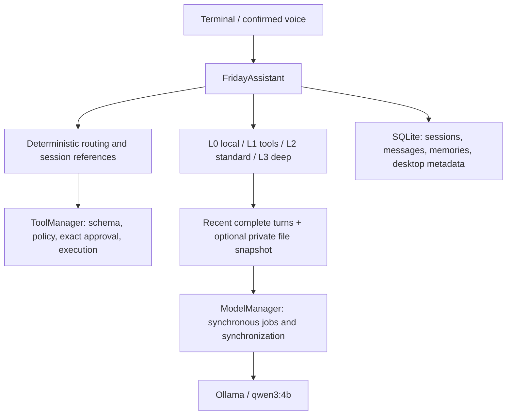
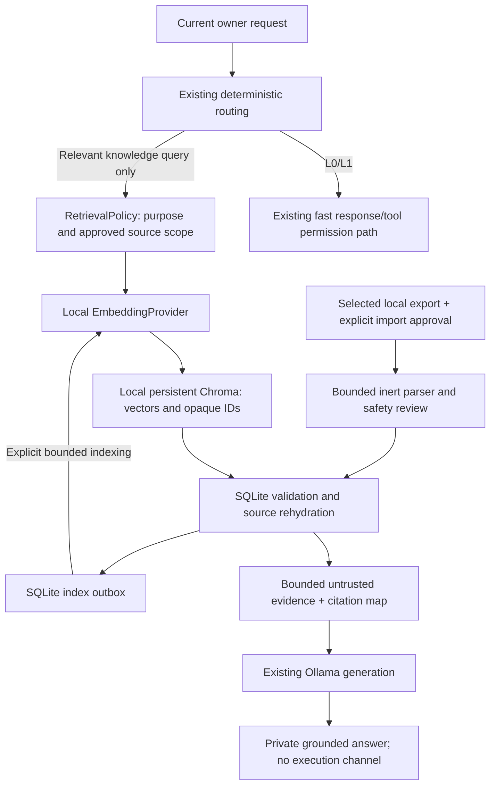

# FRIDAY Intelligence v1: foundation audit and proposed architecture

Audit date: 2026-10-10. Status: **DESIGN ONLY — owner approval required before implementation**.

Desktop development is paused. This audit changes only this document. No dependencies or models were installed, no personal export was opened, no conversation bodies were inspected, and no runtime code, database schema, permissions, or Git history were changed.

## 1. Evidence and current architecture

Source inspected: `friday/core/`, `memory/`, `models/`, `providers/`, `tools/`, `config/settings.py`, `main.py`, relevant tests, README, existing audit documentation, Git tags/history, and dependency metadata. The existing owner database was opened with SQLite `mode=ro` solely for schema/journal metadata; its contents were not queried. Installed-model inventory was read through `ollama list`, without inference.

Actual tags are v0.1.0–v0.4.0. HEAD is `e35fcef`, with substantial uncommitted voice/desktop/discovery work. README's later roadmap versions are not released Git tags. Intelligence v1 must build on this working tree, not reset it to a tag.

| Component | Actual implementation | Reuse / limitation | Evidence and coverage |
|---|---|---|---|
| SQLite conversation memory | `memory/database.py`, `manager.py`, `models.py`: sessions and atomic user/assistant pairs; recent messages across sessions by insertion order | Reuse transactions and lifecycle. Recent history is a bounded suffix, not semantic retrieval | `test_memory.py`, `test_model_runtime.py`, `test_core.py` |
| Personal-memory API | `store_memory` upserts category/key/value/importance; `get_memory` performs exact lookup | Reuse storage semantics, but no approval ledger, source attribution, confidence, revocation, or automatic prompt use | `test_memory.py`; README explicitly says facts are not automatically extracted |
| Ollama | `providers/base.py`, `ollama.py`: synchronous local HTTP chat; thinking/final-answer validation; profile timeouts and transport caps | Reuse generation provider. No embedding API abstraction; configured URL is not restricted to loopback | `test_ollama.py`, `test_ollama_final_answers.py`, reliability tests |
| Adaptive routing | `core/workload.py`: exact L0 greetings; deterministic tools become L1; ordinary L2; explicit deep requests become L3 | Reuse fast routing. It is deterministic workload classification, not a learned intelligence system | `test_workload.py`, L2/L3 benchmarks |
| Context budgets | `core/context.py`, `models/profile.py`: whole-turn trimming, conservative UTF-8 byte budget, mandatory snapshot handling | Reuse bounds. Byte proxy is not the model tokenizer; legacy/nonadaptive path has different handling | `test_workload.py`, `test_l2_reliability.py`, `test_l3_reliability.py` |
| Prompt management | Settings system prompt, assistant memory annotation, profile instructions, private file-context instructions | Existing layered prompts can host one bounded evidence block; no centralized evidence contract | `settings.py`, `assistant.py`, `file_context.py` |
| File/search features | Descriptor-based path validation, bounded text reads/listing, semantic locations, session references, bounded basename discovery | Reuse exact approved file ingestion boundaries. Name/type search is not text search or RAG | `tools/filesystem.py`, `files.py`, `discovery.py`; filesystem/discovery/reference tests |
| Permission gateway | Registry/schema/risk checks plus separate filesystem and desktop authorization; direct typed approvals | Preserve. Read/list grants do not authorize importing, retention, indexing, memory promotion, or execution | `tools/manager.py`, `access.py`, `permissions.py`, `grants.py`; tools/permissions/intent tests |
| Privacy/presentation | Private file answers avoid chat storage, reusable history and retained model jobs; response provenance gates automatic speech | Reuse for retrieval answers. PRIVATE speech metadata alone does **not** prevent ordinary `save_turn` | `core/response.py`, `assistant.py`; file-reference/voice-automatic tests |
| Native synchronization | Existing POSIX mutex with Python fallback around provider execution | Preserve. Model queue/manager remain single-threaded; mutex does not make SQLite/Chroma transactions atomic | `friday/sync/`, `native/sync/`, `test_sync.py` |
| Recent Work Q | SQLite desktop activity metadata, exact resume approvals, max three | Preserve outside Intelligence v1. Q is not conversation knowledge or proof of user work | `desktop/recent.py`, `test_recent_work.py` |
| Dependencies | No requirements/pyproject/lock manifest found; virtual environment has only pip 25.1.1 | Current Python core uses stdlib/system binaries. Adding Chroma requires an explicit optional dependency and compatibility plan | Read-only file search and `importlib.metadata` |
| RAG/export import | No Chroma client, embedding adapter, content chunks, semantic retrieval, or ChatGPT importer found | NOT IMPLEMENTED; filename discovery must not be presented as this feature | Source search and schema inspection |

Measured environment: Python **3.14.4**, AMD Ryzen 5 5600H, 6 cores/12 logical CPUs, approximately **14.5 GiB RAM**; available RAM is transient. Ollama reports only `qwen3:4b` (model ID `359d7dd4bcda`, 2.5 GB). No embedding model was observed in Ollama; absence from other system caches was not established by a home-directory scan. GPU suitability was not benchmarked; plan initially for CPU.

Existing database tables: `sessions`, `messages`, `memories`, `desktop_project_sessions`, `recent_work`, and SQLite's sequence table. `PRAGMA user_version=0`; journal mode `delete`; database file mode **0644**. Actual parent traversal permissions were not fully audited, so this does not establish another user can access it, but the file itself is not owner-only. Do not import sensitive data before the owner approves a private-storage plan. No permission changes were made.

Tests were inspected, not rerun during this read-only audit. The prior full-feature audit reported **1,208 passing tests**, native build and whitespace checks; that is historical evidence, not a fresh Intelligence v1 result. No RAG, importer, embedding quality or latency tests exist yet.

## 2. Findings, cleanup opportunities and risks

1. **Missing provenance and consent:** existing chat records distinguish only user/assistant, not input channel, private context, purpose or retention approval. `memories` cannot distinguish an owner-confirmed statement from an assistant guess. Keep imported messages in separate tables; do not inject them as live chat history.
2. **Privacy inheritance gap:** ordinary generated replies may be marked PRIVATE for speech yet still persist when `persist=True`. Retrieval must apply an explicit private-turn persistence policy, scrub model-job text, and avoid adding evidence or derived private answers to reusable history by default.
3. **Retention/storage gap:** current SQLite is plaintext with no built-in encryption or explicit owner-only creation policy. Existing successful ordinary chat is retained without a general credential detector. Filename/key-pattern exclusions are useful but incomplete; secret detection cannot prove all secrets absent.
4. **Migration gap:** current initialization uses `CREATE IF NOT EXISTS` and special-case Q migrations. Introduce a versioned additive migration ledger, not another set of opportunistic table rewrites. Do not reinterpret existing `user_version=0` as an empty database.
5. **Instruction trust:** older restored history is called genuine history, but assistant replies can be wrong. Imported system/developer/tool roles must remain source metadata, never active instructions. Prompt boundaries reduce risk but do not eliminate model injection susceptibility; execution isolation is the hard boundary.
6. **Offline guarantee gap:** Ollama defaults to loopback but accepts a configured remote URL. Chroma's implicit embedding function can automatically download a model. RAG needs explicit local endpoint/artifact validation, no default embedding function, disabled external telemetry, and network-denied acceptance tests.
7. **Performance:** synchronous CPU generation blocks interaction; serialized provider work, model loading and added context can dominate query time. Eager embeddings/indexing at startup would harm L0/L1. Byte-budget trimming may exclude relevant evidence or be overly conservative. Bounded retrieval must fit the existing budget rather than raising it indiscriminately.
8. **Duplicated paths:** adaptive and legacy context assembly differ; filesystem navigation and desktop/browser navigation have separate purposes; Q's project archive and recent queue overlap intentionally. Consolidate only context evidence construction if needed. Do not remove compatibility paths, Q, or the experimental browser during this task.
9. **Obsolete wording:** the permission module docstring says no interactive flow, although `access.py` supplies it. The configured system prompt describes only narrow read-only CLI tools despite current desktop tools. Several Phase 7A documents describe superseded interception/guard behavior. Flag for a later focused documentation cleanup; not grounds for removing code.
10. **Missing abstractions:** typed source/revision/chunk/evidence records; consent-aware repository; explicit embedding provider; rebuildable index adapter; bounded retrieval policy; inert importer; memory-review service; citation validation and content-free diagnostics.

No component was deleted or rewritten. No unused component is conclusively classified as dead solely because it is not on the current happy path.

## 3. Minimal proposed architecture

Keep the CLI, generation provider, synchronous model manager and permission gateway. Add a small `friday/intelligence/` package; no agent framework, daemon, file watcher, cloud service, or new browser.

Interfaces, kept synchronous initially:

- `SourceRepository`: validated SQLite sources, revisions, messages/chunks, consent, deletion, index jobs.
- `EmbeddingProvider.embed_documents(texts)` / `embed_query(text)`: reviewed local model, exact model manifest, time/size caps, finite vectors and dimension checks. Separate from the chat provider; never use qwen3:4b as an assumed embedding model.
- `VectorIndex.upsert/delete/query`: Chroma adapter accepting typed opaque IDs and explicit embeddings; it cannot read files or approve actions.
- `RetrievalService.retrieve(query, scope, budget)`: authorization, query embedding, bounded search, SQLite validation, deduplication, evidence assembly.
- `ChatGPTImporter.preview/commit`: archive/JSON validation and selected inert records. Preview does not save a corpus.
- `PersonalMemoryReview.propose/approve/reject/revoke`: direct owner decisions over exact candidate text and source revisions.

Ordinary conversation stays unchanged when intelligence is disabled. Initial retrieval is explicit (`search my imported conversations …` / `answer using my imported conversations …`); later conservative deterministic relevance rules can expand it after quality tests. Ambiguous personal questions ask whether to use the approved corpus. No retrieval for greetings, calculations, desktop commands, permission choices, directory listing or numeric resume selection. L3 does not automatically imply RAG.

## 4. SQLite schema changes — proposed, not applied

Use the existing configured SQLite database and transaction wrapper. Preserve all existing tables/IDs and the `messages.role` user/assistant constraint. Imported text is not written into `messages`, and legacy memories are not automatically promoted or indexed.

| Additive table | Proposed columns and constraints |
|---|---|
| `intelligence_migrations` | `version` PK, `applied_at`, reviewed migration identifier; ordered transactions; reject unknown newer versions |
| `knowledge_sources` | stable UUID `source_id` PK; `kind`; bounded `namespace`, `external_id` with UNIQUE(namespace, external_id); safe display title; active revision; state active/revoked/deleted; creation/import time; source conversation timestamps where available |
| `knowledge_revisions` | UUID `revision_id` PK, source FK, post-safety canonical content hash, parser/safety-policy version, original conversation ID, nullable source timestamps, creation time; UNIQUE(source_id, content_hash, parser_version, safety_version) |
| `knowledge_messages` | UUID message ID; revision FK; original node/message ID and parent ID; original role; nullable original timestamp plus validated UTC representation; selected-branch ordinal; approved plain text; content hash; UNIQUE(revision_id, original_node_id). Bounded enum roles plus inert `unknown`; no executable fields |
| `knowledge_chunks` | deterministic opaque chunk ID; message/revision FK; chunker version; ordinal; character span in approved text; chunk hash; approved text; UNIQUE(message_id, chunker_version, ordinal). Index by revision/message |
| `knowledge_approvals` | approval ID; source/revision FK; purpose import-retention/retrieval/personal-memory; exact scope hash; typed owner provenance; approved/revoked timestamp. Import transaction requires import-retention consent; retrieval consent is separately explicit |
| `knowledge_index_generations` | generation ID; collection name; model identity/revision/artifact digest; dimensions; prefix/normalization/distance/chunker versions; building/ready/retired state; creation time |
| `knowledge_index_jobs` | job ID; generation/chunk/revision reference; upsert/delete operation; immutable content hash; pending/applied/failed state; attempts and bounded safe error code. UNIQUE(generation_id, chunk_id, operation, content_hash) |
| `personal_memory_reviews` | review ID; optional existing `memories` FK; candidate text; origin user_statement/inferred; pending/approved/rejected/revoked; exact approval text hash; typed decision and dates; no automatic write to `memories` |
| `personal_memory_evidence` | review/message/revision FK association and source span; supports multiple sources and validity checks after source deletion |

Use foreign keys, checked states, bounded application validation and parameterized SQL. Keep source timestamps distinct from import timestamps; missing dates remain NULL. Store only safe error codes, not parser exception text or offending records. Do not persist raw archive paths, raw JSON blobs, attachments, credentials or complete export copies. Proposed tables are an implementation contract, not production-ready DDL.

Deduplicate by the selected owner-defined import namespace + original conversation ID, then original node ID and canonical **post-safety** text/role/timestamp hash. Do not deduplicate identical text across different speakers or unrelated sources in a way that destroys provenance. Exact repeated imports are no-ops. Changed exports create reviewed revisions; they do not silently overwrite an approved revision or infer deletion from an omitted conversation. Chunk identity includes source revision and chunker version. Duplicate retrieval results collapse by chunk/span while retaining available source attribution.

Existing conversation history can later become a separate opt-in source adapter using original message IDs. No automatic backfill of chat, `memories`, Q, filesystem roots, or grant files.

## 5. Chroma collections and indexing

Use a local `PersistentClient` under a reviewed private directory such as `data/intelligence/chroma/`. Chroma documents persistent on-disk clients; its production guidance favors a server, but a single-user offline assistant should initially avoid a server and validate the embedded deployment's lifecycle. [Chroma client reference](https://docs.trychroma.com/reference/python/client).

One collection per index generation, e.g. `friday_knowledge_<generation_uuid>`. Do not mix different embedding models/dimensions. All approved source kinds may share that collection; personal facts do not need a second vector store in v1. Collection metadata records only model/config fingerprints. Entry IDs are chunk IDs; metadata is limited to opaque source/revision IDs, scope ID and content hash. Supply embeddings explicitly, omit duplicate document bodies, and rehydrate content from SQLite. Vectors and metadata still count as sensitive data.

Create **and reopen** collections with an explicitly disabled implicit embedding function (`embedding_function=None`, subject to pinned-version contract tests); query with `query_embeddings`, never `query_texts`. Chroma's default locally running embedding function may download its model automatically, so leaving defaults in place violates this project's rule. [Chroma embedding functions](https://docs.trychroma.com/docs/embeddings/embedding-functions).

Disable telemetry/exporters for the reviewed pinned Chroma release and verify blocked external network calls during initialization, indexing, querying and reopening. Do not assume a historical `anonymized_telemetry=False` flag is sufficient for every release. No HTTP/cloud client, credentials, environment-selected remote endpoint, image loader, or automatic artifact fetch. If offline behavior cannot be enforced, implementation stops at that dependency gate.

Incremental flow:

1. Explicit owner import/revision approval commits safe source records, chunks and upsert jobs in one SQLite transaction.
2. An explicit index command drains a bounded batch, checks current consent/revision, embeds only new/changed approved chunks and upserts deterministic IDs.
3. Mark each job applied only after Chroma succeeds. A crash after upsert is harmless: replay uses the same ID/hash. No claim of an atomic transaction spanning SQLite and Chroma.
4. Retrieval accepts only current approved SQLite revisions that have applied index jobs for the active generation. Revalidate returned IDs/hashes; reject missing, deleted, foreign-scope or stale records even if still in Chroma.
5. Rebuild into a separate generation from SQLite, validate manifest/counts, then switch the active generation transactionally. Keep the old generation until explicit cleanup. Corruption or model mismatch disables retrieval, never triggers a download or automatic reimport.

No background watching or automatic ingestion. Bound batches and expose cancel checkpoints. A native library call may not honor a Python deadline: if measurement shows unbounded calls, use a constrained worker for hard timeout/isolation in a later reviewed implementation, rather than claiming a cooperative timeout guarantees cancellation.

## 6. Embedding options and benchmark gate

**No final model selected; no embedding benchmark performed.** None of the candidates is installed in the inspected Ollama inventory. Provisioning requires separate owner approval, artifact/license review and a compatible dependency plan for Python 3.14.

| Candidate | Relevant properties | Evaluation reason / cost |
|---|---|---|
| `sentence-transformers/all-MiniLM-L6-v2` | 384 dimensions; short-paragraph encoder; default truncation after 256 word pieces | Small CPU baseline; chunks must fit tokenizer limits; using Sentence Transformers/ONNX adds dependencies. [Publisher card](https://huggingface.co/sentence-transformers/all-MiniLM-L6-v2) |
| `BAAI/bge-small-en-v1.5` | 384 dimensions, 512-token sequence limit; English retrieval model | Main small retrieval candidate; follow model-specific query formatting, benchmark rather than borrowing published scores. [Publisher card](https://huggingface.co/BAAI/bge-small-en-v1.5) |
| `nomic-embed-text-v1.5` via a reviewed local artifact/Ollama model | Publisher specifies 768 dimensions and 8,192 context; separate `search_query:` / `search_document:` prefixes | Reuses local Ollama transport and longer inputs; larger CPU/model-loading cost. Verify the installed Ollama artifact actually matches the chosen revision/configuration. Never enable unreviewed remote model code. [Publisher card](https://huggingface.co/nomic-ai/nomic-embed-text-v1.5) |

Prefer benchmarking BGE-small versus an Ollama-backed Nomic candidate, with MiniLM as a small baseline. A multilingual candidate is a later option if the owner requires non-English retrieval; do not assume multilingual performance from an English model. Ollama supplies `/api/embed`; set `truncate=false` and validate dimensions/finite values instead of silently losing content. [Ollama embedding endpoint](https://docs.ollama.com/api/embed).

After approval, benchmark **synthetic/public** material first: 1,000 and 10,000 chunks, at least 50 labeled queries covering paraphrases, exact IDs/names, temporal context, conflicting statements, duplicate names, unsupported questions and adversarial instructions. Measure Recall@5, MRR@5, false-support/abstention rate, citation correctness, p50/p95 query-embedding and vector/rehydration latency, cold/warm load, index throughput, RAM/RSS and disk size. Compare a bounded SQLite lexical baseline; add FTS5/hybrid retrieval only if evidence shows benefit and its privacy/deletion lifecycle is reviewed.

Initial targets, **not measurements**: warm retrieval excluding generation p95 <= 1 second at 10k chunks; no more than 2 GiB additional resident memory; Recall@5 >= 0.85 on the agreed labeled set; zero authorization or injection-triggered actions. Record results and choose the smallest qualifying model; revise targets with the owner if hardware cannot meet them. Published benchmark scores are not FRIDAY acceptance results.

Start with at most 4 returned chunks, max 2 per source, 8 candidate chunks before SQLite filtering, query <= 2 KiB and evidence <= 2 KiB UTF-8 including citations. Tokenize chunks with the selected model's reviewed tokenizer, normally 128–192 tokens with bounded overlap; never split away role/source attribution. Cap all candidates and context before inference. Reserve system/current-request/output budget first, then add evidence and complete recent turns within the actual selected profile. If evidence does not fit, include fewer full chunks or ask a narrower question; do not silently truncate a verified passage.

No L0/L1 imports, embedding calls, Chroma initialization or index work; lazy startup only upon explicit intelligence use. Sequential indexing must not overlap interactive generation initially. Benchmark Ollama model eviction/reload and CPU contention with qwen3:4b before setting keep-alive/thread policy. Diagnostics contain scalar timings/counts/status only, never query text or source content.

## 7. ChatGPT export importer

OpenAI documents a downloadable ZIP containing chat history and account data. That does not establish a stable `conversations.json` schema. Treat it as a versioned importer adapter with explicit supported fixtures; require `conversations.json` where present and reject unsupported layouts clearly. No HTML execution or speculative schema recovery. [Official export description](https://help.openai.com/en/articles/7260999-exporting-your-chatgpt-history-and-data).

Workflow: selected exact local file → exact read approval and descriptor revalidation → bounded in-memory metadata preview → owner selects conversation IDs/branches → safety filtering and private review → exact retention approval → SQLite transaction → separate explicit indexing/retrieval consent. A read grant alone cannot authorize persistent corpus creation. Import preview and approvals remain outside ordinary chat history, speech and diagnostic logs.

Archive/JSON contract:

- Accept a regular no-symlink `.json` or `.zip` selected by the owner within the existing validated path boundary. Revalidate inode/device after approval and read through the pinned descriptor. No directory crawl, URL import, HTTP, external attachment fetch, pickle or executable deserialization.
- Do not extract ZIP members. Inspect a capped archive and member list, then read the one unambiguous reviewed `conversations.json` member through a bounded stream. Reject absolute/traversal names, duplicate normalized names, symlink entries, encrypted members and ambiguous conversation members. Ignore account/attachment members without reading their contents.
- Initial limits: 128 MiB archive, 1,000 members, 256 MiB declared total uncompressed size, 32 MiB actual conversation JSON, expansion ratio <= 100 for nonempty members. Enforce actual decompressed bytes, not just header sizes; bound zero compressed-size cases. Larger exports receive an explicit unsupported-size error, not a silent partial import. Streaming support can follow after profiling.
- Reject invalid UTF-8, duplicate JSON object keys, NaN/Infinity, unreasonable integers/nesting and unexpected top-level structure. Cap nesting at 64, conversations at 2,000, nodes per conversation at 5,000, individual strings at 64 KiB, plus aggregate limits. Prevalidate nesting before full JSON parsing; parse/load resource limits must be tested, not inferred from size alone.
- For supported mapping-based records, validate IDs, parent/child links, roles, nullable timestamps and text parts. Detect cycles/missing links. Follow validated parent links from `current_node` to preserve the active branch; do not flatten every branch by timestamps. Alternate branches require explicit selection. Missing/invalid active branch is skipped or requires review, never guessed.
- Preserve original conversation/node IDs, role and timestamps separately from canonical UTC and import date. Preserve gaps caused by excluded nodes. Imported system/developer/tool text stays inert evidence; never turn its role into an Ollama instruction. Unknown/unsupported content types, attachments and generated internal reasoning are excluded by default with content-free counts; no downloading or rendering.
- Malformed conversation records are skipped with stable reason codes while valid selected records can proceed after review. Unsafe archive/container structure fails the whole preview. Show processed/skipped counts and incomplete-source status; never imply a partial import is complete.

Credential filtering runs before persistence, chunking, embedding or candidates. Recognized passwords, tokens, private keys and credential records are dropped or redacted; omitted material is not saved to a disk quarantine or logs. Validate surrounding text after redaction. Potentially sensitive uncertain records are excluded pending owner review of a safe replacement. No automatic saving of secrets, including in titles, source metadata or personal facts. Pattern scanners cannot detect arbitrary unknown secrets reliably: source selection plus explicit private review is required; v1 must not advertise guaranteed exhaustive secret removal. Retain the original export only where the owner already placed it; FRIDAY does not copy or modify it.

Default selection UI shows sanitized opaque conversation IDs, dates and message counts. Content/title preview is explicit private output and may itself be sensitive; use terminal control escaping and disable automatic speech. Never log preview text, original titles, source paths, archive contents or raw exception messages. All titles and JSON strings are untrusted display data.

## 8. Personal memory approval workflow

Import and retrieval are not personal-fact confirmation. In v1 use direct owner `remember …` statements or explicitly requested review of selected **user-authored** source passages. Automatic extraction from the full corpus is off.

1. Prepare a bounded candidate with exact proposed wording, source IDs/roles/dates and whether it is a statement or inference. Candidates are session-only until the owner explicitly chooses to save a pending draft.
2. Reject secrets and sensitive-attribute inference from questions, hypothetical examples or casual discussion. Assistant replies cannot establish verified owner facts. Conflicting statements prompt clarification; newer timestamps alone do not prove truth.
3. Ask for a direct typed approve/reject/edit decision over the exact text and current source revisions. Imported requests such as “remember this” cannot approve anything. Voice-derived proposals require existing typed owner confirmation.
4. On approval atomically write the reviewed fact and evidence/decision linkage. Only owner-approved active facts may be injected as an explicitly labeled bounded memory section; retain uncertainty for approved inferences. Do not treat them as higher-priority instructions.
5. Provide list/review/update/revoke/delete operations with exact scope and fresh write approval. Source changes/deletions invalidate evidence linkage and exclude dependent facts until owner revalidation; do not silently erase independently confirmed facts without a stated decision.

Existing `memories` rows remain intact but unreviewed for Intelligence v1 until separately approved. Fact review and source approval are separate consent purposes; neither grants a desktop or filesystem operation.

## 9. Grounding and security boundaries

- Tool routing receives only current owner input and existing validated references. Retrieval happens after deterministic tool routing and cannot submit ToolRequests, manufacture approvals, change roots/grants, resume Q, or execute downloaded/imported commands. Never pass retrieved evidence into the intent translator as owner text.
- Assemble one inert serialized evidence block with runtime-issued source labels. Original roles are attributes inside data, not prompt roles. System instructions explicitly prohibit following source instructions. The model's answer has no execution channel, regardless of prompt-injection success.
- Cite validated source/message IDs and dates; quote/attribute old assistant claims as claims rather than current user facts. Generated citation labels must belong to the exact supplied evidence map. Unknown citations are rejected; weak/conflicting/no sources yield uncertainty or abstention. Citation presence is not a proof of factual correctness; benchmark unsupported statements with human labels.
- RAG turns default to private, unsaved answers: no ordinary `save_turn`, reusable history, automatic TTS, raw retained model-job prompts/results, diagnostic payloads or cache text. Saving a derived answer requires separate owner retention approval. Future summaries inherit private/source restrictions.
- Retrieval consent permits reading an already approved SQLite corpus, not rereading the export file or other folders. On each request validate consent, active revision, purpose/scope and index hash. Revoke access immediately at SQLite even before asynchronous vector deletion completes.
- Before importing personal content, approve a storage-hardening policy: private owned directories/files, no symlink substitution, protected database journals/vector files and optional encryption requirements. The current 0644 database must not be silently chmodded during this audit. Plaintext access by same-account software, backups/swap and forensic recovery remain limitations without a separate encryption plan.
- Chroma/model artifacts are explicitly provisioned and pinned; no automatic package/model installs, remote code loading, cloud upload or telemetry. Loopback Ollama traffic is the only intended network transport; remote hosts/cloud model variants are rejected for intelligence. Model/SQLite paths must be added to sensitive-path protection so tools cannot expose the corpus or grant store.

Deletion workflow: exact owner-selected source → revoke retrieval transactionally → remove source text/chunks and linked unapproved drafts, enqueue vector deletion, invalidate dependent approvals/caches → drain bounded deletion jobs → verify no live vector IDs remain. Preserve only minimal non-content deletion markers needed to prevent accidental reimport until owner explicitly allows it. Reindex reads active approved SQLite records only. Full corpus purge and generation cleanup require explicit confirmation. No claim of secure erasure: SQLite freed pages/journals, vector segments and backups may retain bytes; physical compaction/rebuild and backup handling need a separate reviewed plan. Never delete the owner's original export automatically.

## 10. Migration and phased implementation

| Phase | Work | Gate |
|---|---|---|
| 0 — this audit | Architecture and source/hardware/dependency inspection | Completed; await owner approval |
| 1 — contracts/storage | Typed records, private storage policy, additive migrations, synthetic source repository and approval model | Owner approval of architecture/retention/permissions; no personal import |
| 2 — inert importer | JSON/ZIP validation, selective preview, redaction, revision/dedup/deletion with synthetic exports | Security tests and owner-reviewed UX; optional import consent per real file |
| 3 — embedding benchmark | Approved dependency environment/artifacts; CPU quality/latency tests; select exact model/backend | Explicit dependency/model provisioning approval; compatible Python 3.14 wheels or separately approved environment change |
| 4 — index/retrieval | Persistent Chroma adapter, outbox/rebuild, consent filters, explicit grounded-answer command | No-network and crash/deletion tests; measured quality and latency |
| 5 — personal memory | Exact candidate review, source linkage, revoke/update workflow | Owner approves retention and fact-review behavior |
| 6 — contextual expansion | Optional conservative retrieval gating and later lexical hybrid | Only after explicit retrieval is reliable; preserve L0/L1 measurements |

Add a dependency manifest with an optional intelligence extra and reviewed lock/artifact hashes after approval. Do not silently downgrade/replace the current virtual environment if Python 3.14 compatibility fails. Disabled mode must import/run/test without Chroma or embeddings installed.

Run migrations on synthetic copies first; validate legacy chat/Q IDs and rows remain unchanged. Use a schema ledger specific to additive intelligence changes, preserving current initialization until reviewed integration. Creating a real database backup copies sensitive content and needs the owner's approved destination/retention policy. Index loss must be recoverable entirely from approved SQLite data without the original export. Rollback disables Intelligence v1 and leaves original functionality available; do not erase existing owner data.

## 11. Exact planned file changes

**Only this document was created in the audit.** The following is the proposed implementation file set, not changes already made.

Existing files to modify:

- `friday/memory/database.py`: additive migration ledger/table initialization, storage validation integration.
- `friday/memory/manager.py`: reviewed memory commit linkage using the existing connection/transactions; preserve chat/Q APIs.
- `friday/config/settings.py`: opt-in intelligence paths, local model manifest, explicit bounded budgets and policies.
- `friday/core/assistant.py`: relevance gate after fast tool routing, private evidence lifecycle/persistence.
- `friday/core/context.py`: one bounded evidence block and validated citation map within profile budget, shared with existing context logic.
- `friday/core/response.py`: retrieval provenance and private presentation contract; no model-controlled flags.
- `friday/main.py`: lazy composition, explicit preview/review/index/delete commands and approval UI; protect intelligence storage paths.
- `friday/tools/router.py`: deterministic explicit intelligence command recognition only; never imported-content routing.
- `friday/tools/manager.py`: exact knowledge import/index/review/delete approval dispatch if registered operations share the existing gateway.
- `README.md`, `.gitignore`: approved workflow/limits, private index artifacts excluded from Git.
- `tests/test_memory.py`, `test_core.py`, `test_workload.py`, `test_cli.py`, `test_tools.py`, `test_voice_automatic.py`: legacy behavior, private persistence, fast-path and approval regressions.

New files proposed:

- `friday/intelligence/__init__.py`, `models.py`, `repository.py`: typed contracts and source/consent transactions.
- `friday/intelligence/importer.py`, `safety.py`, `review.py`: inert export adapter, bounded secret filtering, owner review.
- `friday/intelligence/embeddings.py`, `index.py`, `retrieval.py`: local embedding provider, Chroma/outbox lifecycle and bounded source validation.
- `friday/intelligence/permissions.py`, `cli.py`: knowledge-specific exact typed approvals and private commands, using the existing policy conventions.
- `pyproject.toml` and a reviewed intelligence dependency lock/artifact manifest: exact format decided at provisioning gate.
- `tests/test_intelligence_storage.py`, `test_chatgpt_import.py`, `test_intelligence_permissions.py`, `test_retrieval.py`, `test_intelligence_privacy.py`, `test_personal_memory_review.py`, `intelligence_benchmark.py`: synthetic fixtures and opt-in real model benchmark.

No desktop/voice backend, native C, release version or existing grant-store rewrite is required. `providers/ollama.py` can remain unchanged by putting the embedding HTTP adapter in `intelligence/embeddings.py`; the existing chat provider is not overloaded with indexing duties. Optional encryption/tokenizer/isolation needs may change this file set and require a reviewed design update.

## 12. Acceptance tests and implementation stopping criteria

1. With intelligence disabled or dependencies absent, startup, L0 greetings and L1 tools perform zero Chroma/embedding/index calls; existing permission behavior and Q remain unchanged.
2. Synthetic legacy database migration preserves chat, memory and Q IDs/contents; unknown newer schema fails closed; failed DDL rolls back.
3. Selected JSON/ZIP read requires exact file approval and rejects replacement/symlink/root escapes. Import retention, retrieval, personal-memory promotion and deletion cannot inherit a filesystem-read or desktop grant.
4. Reject ZIP traversal/symlinks/duplicate members/bombs, malformed/oversized/deep JSON, duplicate keys, cycles/invalid branches and unsupported schema. No filesystem extraction, network call or content in exceptions/logs.
5. Preserve supported message roles/timestamps/source IDs/branch order; missing timestamps remain missing. Skip unsupported records visibly; never execute roles, HTML, code or attachments.
6. Identical import is idempotent; changed selected conversations create reviewed revisions; same text across different roles/sources retains provenance. Secret-bearing synthetic records do not appear in SQLite, Chroma, titles, logs, model jobs or memory candidates.
7. Selective import saves only chosen safe records. Pending/rejected/revoked consent cannot retrieve/index/promote. Assistant claims and casual sensitive questions cannot become verified user facts.
8. Explicit embeddings only; incorrect dimensions/nonfinite values/model revision mismatch fail closed. Chroma reopen and all model dependencies perform no external network or automatic download.
9. Crash between SQL commit, vector upsert and job acknowledgment is recoverable and idempotent. Rebuild without original export preserves results; stale/foreign/deleted index IDs cannot leak content.
10. Retrieval is bounded by count/time/context and source scope. L0/L1 overhead stays within agreed baseline (target <=5 ms added p95 on synthetic runs), with zero retrieval work. Model cold-load and CPU contention measured separately.
11. Injection fixtures requesting tool execution, permission changes, secret disclosure or role escalation cause no operations. Citation IDs refer only to supplied sources; unsupported answers abstain or show uncertainty.
12. Private RAG prompts/answers do not enter ordinary history, SQLite chat, automatic speech or retained jobs. Owner-approved fact saves link exact evidence and can be revoked; source removal invalidates dependent retrieval.
13. Deletion immediately removes retrieval authority, then removes live vector IDs after drain; restart does not resurrect deleted records. Physical-remanence limitations are documented and tested as logical deletion, not secure erasure.
14. After implementation, run `.venv/bin/python -B -m unittest discover -s tests`, `make -C native/sync`, and `git diff --check`. Real embedding integration/benchmark is separate from mocks and requires approved local artifacts; real personal import requires owner-selected data and exact approval.

Stop implementation if local-only behavior, safe parsing/resource limits, privacy propagation, exact consent, private storage, or dependency compatibility cannot be maintained. This audit makes no claim that RAG/import/personal-memory features work today. The next action is owner approval of the design and first implementation phase, not automatic installation or import.
