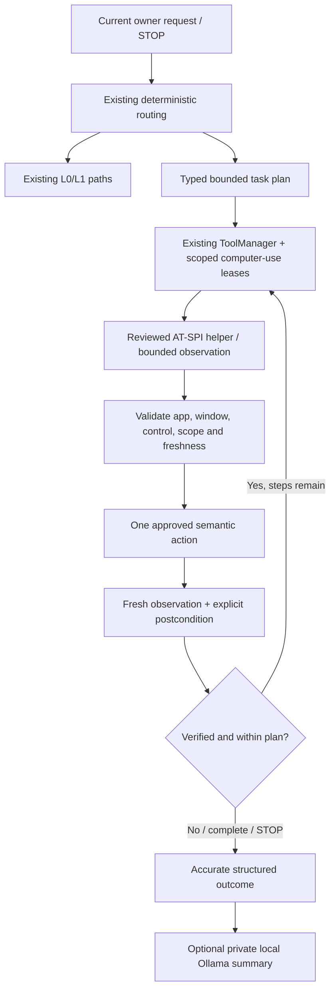

# FRIDAY Phase 0.5 — permission-controlled computer use

Checkpoint 3I: the reviewed Firefox URL handoff now supports the owner's exact
YouTube, LinkedIn profile, WhatsApp Web, GitHub profile and PW study URLs, with
deterministic standalone/compound aliases. Each request needs fresh hidden owner
authentication and exact Allow once approval; page load remains unverified.
All 347 targeted tests and 1,532 regression tests passed. No live website opening
occurred. See [the Checkpoint 3I report](FRIDAY_PHASE05_CHECKPOINT3I.md).

Checkpoint 3H: the exact YouTube workflow now has a separate executable Firefox
Snap URL handoff, gated by fresh hidden owner authentication and exact Allow once
approval. It reports request acceptance with page load explicitly unverified;
AT-SPI and final-URL verification are not prerequisites for this narrow handoff.
Other target workflows and the general Snap app-only policy retain their existing
restrictions. No live navigation has been performed. Phase 1 remains paused.
See [the Checkpoint 3H report and one-time live-test procedure](FRIDAY_PHASE05_CHECKPOINT3H.md).

The checkpoint entries below describe their historical state.

Checkpoint 3E: deterministic browser dispatch, exact YouTube/search policy,
fresh owner authentication, one-use permission leases and navigation evidence
contracts are implemented and mock-tested. All 1,467 regression tests passed.
Production Firefox execution remains disabled: neither attributed Firefox
registration nor exact final-URL verification has been established. No live
browser action or real `.env` access occurred. See the
[Checkpoint 3E report](FRIDAY_PHASE05_CHECKPOINT3E.md) for the backend review,
limitations and separately approved diagnostic/live-test prerequisites.

Checkpoint 3D: four distinct application handoff tools and a verification gate
are implemented and mock-tested. Production target handoffs remain disabled
because exact VS Code target verification and Firefox attribution/navigation
verification are unavailable; Snap remains app-only. See the
[Checkpoint 3D report](FRIDAY_PHASE05_CHECKPOINT3D.md) for boundaries and live-test prerequisites.

Checkpoint 3B/3C update: file opening is separated from reading, recent filenames
are revalidated, consumed selections fail safely, and owner authentication has
been integrated as an additional sensitive-operation gate. Real Argon2 validation
is blocked pending dependency approval. Real desktop input and Snap handoffs
remain disabled. See [the implementation and validation report](FRIDAY_PHASE05_CHECKPOINT3BC.md).
The historical findings below are not new live observations.

Date: 2026-10-10. **Checkpoint 2D metadata-only observation implemented; real desktop control remains unsupported.** See section 16 for the current status and section 15 for the Checkpoint 1 history. Sections 1–14 retain the original architecture/feasibility findings and future milestones.

Phase 1 ChromaDB/RAG work is paused until Phase 0.5 is complete. During the initial architecture audit, no runtime code, dependencies, models, desktop settings, Snap connections or database records were changed; this report was its only new file. The separately approved Checkpoint 1 adds the foundation described below. Neither stage launched/focused applications, activated real controls, entered real text, captured screenshots or enumerated live window/page contents. No Git commit/push. Existing uncommitted work and the Phase 1 proposal remain intact.

Read-only session/bus metadata and one existing headless test required approved execution outside the filesystem/socket sandbox. Those approvals authorize the specific diagnostic/test commands, not future desktop control. Public upstream documentation was consulted; no private project or desktop content was uploaded.

## 1. Decision and smallest feasible implementation

Choose **AT-SPI through installed system PyGObject**, accessed by a small reviewed helper process. Start with application-specific semantic actions and editable controls, not global mouse/keyboard injection. Reuse FRIDAY's existing typed tool gateway, launch registry, exact approval leases, file identity checks, private VS Code profile and synchronous Ollama manager.

The four requested demonstrations are **conditionally feasible**, not already working. The first approval-gated milestone must establish that the selected real VS Code and Firefox windows expose usable controls and reliable target identity on this Wayland/Snap installation. Accessibility is currently disabled. If target attribution, editable text, folder selection or postconditions are missing, stop with an unsupported/incomplete result; do not substitute coordinates or a process-launch receipt.

No new pip packages or models are proposed for the AT-SPI-first path. General physical keyboard shortcuts and coordinate mouse input require a separately reviewed Wayland portal backend and are not silently authorized by this design.

## 2. Existing capability audit

Inspected `friday/core/assistant.py`, `context.py`, `workload.py`; `providers/ollama.py`; `models/manager.py`, `profile.py`; desktop registry/runtime/routing/Snap/navigation/browser/recent/session modules; tools gateway, discovery, access, sensitive paths and intent validator; sync Python/C code; related tests and architecture/desktop reports.

| Capability | What works in the current implementation | Missing / reusable boundary |
|---|---|---|
| L0–L3 | Deterministic adaptive greetings/tools; standard/deep inference profiles and bounded context | Adaptive routing defaults off. Keep both paths; no observation or LLM for L0/L1 that do not need computer use |
| Ollama | Local stdlib HTTP chat, final-answer checks, single-provider ModelManager, private-turn cleanup | Reuse qwen3:4b for optional plan interpretation and summaries; no vision/OCR/embedding model |
| Tool gateway | Registered schemas, risk policy, exact desktop/filesystem execution leases, denial handling | Add narrow computer-use tools and capability-specific checks through the same gateway |
| Native launcher | Administrator-owned ELF allowlist, pinned executable/target descriptors, sanitized environment, post-approval identity checks, four-process session limit | Launch outcomes explicitly leave window/target verification unconfirmed; retain this truthfulness |
| VS Code | Native project opening uses private profile, extensions disabled, automatic tasks off, workspace trust enabled | Installed Snap target-path launch remains blocked. No editor window observation, focus, Open Folder UI or verified project result |
| Reviewed Snap | Exact Code/Firefox identities/publishers/confinement/runtime metadata; app-only exception; no arbitrary launcher parsing | `ReviewedSnap.arguments` rejects every path/URL. Preserve that restriction; new UI selection is a separate proposed capability, not a dispatcher exception |
| Firefox | Reviewed app-only launch; native URL mechanism supports only exact `https://github.com/` catalog entry | No search routing, address-field input, results verification or webpage reading; query URLs are currently rejected |
| Discovery | Exact scopes and approved roots; no-symlink identities; depth 3, entries 1,000, results 20, time bounds | Reuse alias/path resolution; discovering a target gives neither file retention nor UI authority |
| Recent work / Q | Three distinct SQLite activities with stable descriptors; fresh approval on resume; recorded launch outcomes | Q is not a window map or proof of project/page visibility. Keep existing descriptors and persistence semantics |
| FRIDAY Browser | Separate managed GTK folder renderer, authenticated socketpair, bounded protocol/history, explicit folder navigation/list permission | A location-label acknowledgment is specific to this renderer. It is not Firefox/web retrieval or automation of other applications |
| Nautilus | Reviewed native folder launches and pinned target handoff; current runtime attempts freshly approved opens | Reliable same-window navigation remains unavailable. Do not extend historical suppression behavior or rewrite this path |
| Synchronization | Native process-local ERRORCHECK POSIX mutex, Python fallback; single-threaded model jobs | Preserve for model execution. It does not lock the compositor, a browser, user input, SQLite globally or another FRIDAY process |
| Emergency stop | CLI handles interrupts; generation remains synchronous | No running computer-use task/STOP dispatcher exists. A synchronous `input()` loop cannot accept typed STOP during a blocking task |

Current code is authoritative where older reports/docstrings conflict. For example, Files suppression text remains in the navigation module, but the current runtime deliberately attempts each freshly approved native request. No unrelated cleanup is proposed.

## 3. Actual Ubuntu session and interfaces

Observed on this host:

| Evidence | Finding |
|---|---|
| OS | Ubuntu **26.04.1 LTS**, x86-64 |
| `loginctl show-session 2` | Active local user session, `Type=wayland`, `Remote=no`, `State=active` |
| Environment | `XDG_CURRENT_DESKTOP=ubuntu:GNOME`, `WAYLAND_DISPLAY=wayland-0`, `DISPLAY=:0` |
| Session runtime | `/run/user/1000`, mode 0700; session bus present |
| GNOME Shell | **50.1-0ubuntu1.2** installed |
| Accessibility bus | `org.a11y.Bus` owned; GetAddress returned `/run/user/1000/at-spi/bus` |
| Accessibility status | **IsEnabled=false, ScreenReaderEnabled=false**; no status was changed |
| System bindings | `/usr/bin/python3 -I -B` imports `gi.repository.Atspi` with typelib 2.0 successfully |
| Static installed API checks | `Action`, `EditableText`, `Component`, `EventListener`, `get_desktop`, `set_timeout` exist; no desktop enumeration invoked |
| Project virtual environment | Python 3.14.4; `gi`, `pyatspi`, `Xlib`, `dbus` imports unavailable |
| RemoteDesktop portal | Runtime interface version **2**, AvailableDeviceTypes **7** (pointer, keyboard, touch) |
| ScreenCast portal | Runtime interface version **5**, AvailableSourceTypes **7**, AvailableCursorModes **7** |
| Installed Code Snap | Revision **264**, application version **1.138.0** from packaged metadata, classic confinement |
| Installed Firefox Snap | Revision **8763**, packaged version **154.0-1**, strict confinement; package declares X11/Wayland plugs |
| X11 utilities | `xprop` installed; `xdotool`, `wmctrl`, `ydotool` not found on inspected PATH |

Portal availability is not permission to create a session/capture/input. Snap plug declarations are not proof of active connections, accessible UI exposure or end-to-end operation. Snap revisions can change; revalidate metadata before launch/use. Root ownership and actual process identity must be checked by the existing reviewed runtime, not inferred from package version strings. No active-window identity, control tree, screenshot support/version, Firefox page text or real focus result has been established.

The source GIR XML was absent at `/usr/share/gir-1.0/Atspi-2.0.gir`; API checks used the installed typelib instead. Online AT-SPI references currently describe a newer library than the installed 2.60.4 package, so implementation must probe/test the installed API rather than assume every documented method exists.

## 4. Technology selection and support limits

| Technology | Decision |
|---|---|
| AT-SPI + PyGObject | Primary. Semantic `Action.do_action`, `EditableText.insert_text`/explicit replacement and `Component.grab_focus`; inspect roles/states/interfaces before text |
| GNOME / Gio D-Bus | Read session/capability metadata and resolve service owners/processes. No Shell Eval, private compositor control, extension install or security-setting bypass |
| X11 tools | No general backend on this Wayland session. `DISPLAY=:0` indicates possible XWayland, not an X11 session. Future X11 support requires separate exact-target/XID verification and tests |
| AT-SPI generated mouse/key events | Do not assume these work across native Wayland windows or have safe receiver scoping. Excluded from first implementation |
| RemoteDesktop portal | Supported capability advertised; fallback candidate for genuine key/pointer events only after separate owner/portal consent and scope review. Session authority can be broader than one window |
| ScreenCast / Screenshot portal | Optional explicit capture fallback; not required or approved for initial AT-SPI milestone. Prefer owner-selected single-window capture where supported |
| OCR | Deferred until a specific accessibility failure justifies it. No OCR dependency or model proposed; OCR text alone cannot establish target identity or authorize an action |
| FileChooser portal | Can create a chooser for its caller; it is not an API to control an arbitrary VS Code/Firefox chooser. Use the target application's accessible dialog |
| OpenURI portal | Chooses/defaults a handler; does not guarantee Firefox, the intended window or project trust profile. Not a replacement for exact app/target verification |
| Selenium/Playwright/CDP, arbitrary browser extensions, uinput/root daemons | Not proposed. They add dependencies or broader authority and do not solve the first accessibility feasibility gate |

AT-SPI focus is an attempt, not a guarantee that the compositor activated the intended window. A successful action return means invocation succeeded, not that the requested business outcome occurred. [Focus API](https://gnome.pages.gitlab.gnome.org/at-spi2-core/libatspi/method.Component.grab_focus.html), [action API](https://gnome.pages.gitlab.gnome.org/at-spi2-core/libatspi/method.Action.do_action.html), [editable text API](https://gnome.pages.gitlab.gnome.org/at-spi2-core/libatspi/method.EditableText.insert_text.html).

Wayland fallback consent and session/device scoping are described by the [RemoteDesktop portal](https://flatpak.github.io/xdg-desktop-portal/docs/doc-org.freedesktop.portal.RemoteDesktop.html). Do not equate a selected screencast window with keyboard input restricted to that window. If the backend cannot ensure the receiver under the required policy, `press_key` remains unsupported; semantic actions/manual owner interaction are the fallback.

## 5. Proposed architecture

Initial proposed files: `friday/desktop/observation.py` (typed snapshots/capabilities), `computer_use.py` (action validation/leases), `accessibility.py` (backend interface), `accessibility_worker.py` (system-GI worker), `tasks.py` (plan/state/cancellation), `web_content.py` (future source-aware accessible reading). Section 15 records the actual Checkpoint 1 modules; webpage reading remains unimplemented.

Make only narrow integration changes in routing/tool registration/settings/CLI/presentation/assistant private-context handling. Keep current app-only launch tools and Snap arguments intact. Add a separate `computer_use_task` gateway entry whose internally dispatched action tools each undergo schema and capability checks; a task approval is an enumerated set of exact steps, never a general EXECUTE override. The existing risk policy alone is insufficient for typing/navigation scope.

Reuse the managed renderer's secure transport pattern, not its navigation acknowledgment as desktop proof: pinned administrator-owned system interpreter, reviewed worker bytes, sanitized imports/environment, private anonymous Unix socketpair, sequence/request IDs, bounded messages and no public listener. The helper must have no arbitrary code, command, filename loader or URL-fetch method. AT-SPI availability outside `.venv` is why a separate helper is appropriate; do not mutate `.venv` to import system packages.

Use one task/controller at a time; all GTK/AT-SPI calls on the helper's designated thread, all ModelManager calls on their existing single-threaded path. Preserve the native model mutex. Use a separate controller execution state/cancellation primitive for desktop work, not the native non-reentrant model mutex around a whole task or owner approval.

## 6. Observation contract and target identity

Before selected-window observation, request exact observation scope. If the window is not yet known, request a bounded metadata-only discovery scope for the named application, then let the owner choose if ambiguous. Do not dump all window titles/content. The bus may enumerate application registrations internally for resolution, but collect no unrelated accessible names/text; document the broader same-user accessibility authority.

Window/control IDs are runtime-issued opaque handles, not titles, coordinates or LLM-supplied D-Bus paths. Bind a window to the current session, unique accessibility bus owner, accessible application/window object, validated process identity/start time and reviewed native/Snap executable identity. Treat advertised AT-SPI PID/app/name/role attributes as untrusted; compare with bus-owner credentials and `/proc` identity where available. Electron/browser multiprocess mappings require a reviewed rule and a real test. Never substitute title matching if attribution fails. A new launcher PID may be a dispatcher or forward to an existing process.

Owner-selected reuse is permitted only for an independently attributed window and fresh scope consent. Reuse does not imply it was created by FRIDAY. Prefer a FRIDAY private VS Code instance to a personal-profile window; do not switch to the owner's unrestricted editor profile to make a test pass.

`WindowSnapshot` contains opaque identity, role/state/interface metadata, active/focused evidence when available, bounded controls, safe labels, observation timestamp/generation and explicit capability/unknown flags. Distinguish visible/showing, mapped, focused and selected; none automatically proves compositor visibility. Use role/state/sensitive checks before fetching text. Offscreen/hidden/defunct elements are excluded from visible-text results. A virtualized document may expose incomplete text; report truncation/coverage.

Controls bind to window and snapshot generation; validate ancestry, role, allowed semantic action, enabled/showing/editable state and freshness immediately before dispatch. Clear cached targets after navigation, dialog replacement, closure, bus-owner change or focus ambiguity. “Search box” and “first result” require one unambiguous eligible control in the current approved window/task; never default to a control in another application.

Sensitive controls/windows: password/protected entry, authentication/credential/permission dialogs, secret-manager/payment interfaces and uncertain classifications stop ordinary tasks. Do not read their names/text/value, type credentials or approve trust/security controls automatically. State/role filters cannot perfectly detect all sensitive content; first demos therefore use owner-selected known nonsensitive windows and synthetic input. Unknown windows do not get a permissive capture fallback.

If accessibility is insufficient, propose capture separately: owner selects a known nonsensitive single window, confirms no authentication/private overlays, and grants an exact one-operation capture purpose; the OS portal must also consent. Refuse whole-desktop capture when safe source isolation is uncertain. Prefer a bounded single-window ScreenCast frame held in memory, with explicit resolution/byte limits and immediate session closure, rather than continuous polling. No persistent restore token, frame cache, raw screenshot logs, uploads or implicit OCR/model use. Screenshot portals may create a temporary image URI: review that storage/retention and exact temporary-artifact cleanup policy before using that route. Do not promise screenshots never touch disk merely because FRIDAY does not save them. Capture consent does not grant input, text reading outside the selected source, or permission to capture credentials; sensitive capture would require a distinct specific owner authorization and remains excluded from these demos.

## 7. Typed operations and result verification

Public operations may use a current selected-target handle; internal requests must always carry its explicit identity/lease. No ambient global typing.

| Operation | Validation and intended implementation | Verification / limitation |
|---|---|---|
| `open_application(app_id)` | Existing registry and exact launch permission | Existing accepted/unverified receipt; separate observation confirms window |
| `focus_window(window_id)` | Attributed target, focus permission, supported Component | Reobserve focused/active state; refuse global input when focus uncertain |
| `observe_window(window_id)` | Scope/expiry, bounded subtree, sensitive filtering | Typed snapshot, missing attributes marked unknown |
| `click_control(control_id)` | Allowed Action in exact current snapshot; semantic activation permission | Invoke exact action, verify expected control/dialog/page state; no coordinates |
| `type_text(text)` | Exact control + text + insertion/replacement mode; <=2,048 UTF-8 bytes initially; no password, terminal or editor buffer under basic typing scope | EditableText change and bounded readback/caret check. Insertion does not submit; replacement needs explicit approval |
| `press_key(approved_key)` | Finite reviewed key/chord enum plus window/context/effect permission | First backend exposes unsupported for physical keys absent a reviewed sender. Enter/Escape may be implemented as explicitly labelled semantic submit/dismiss actions, without claiming a key was sent |
| `select_menu_item(item_id)` | Exact safe menu action and current parent/ancestry | Expected menu/dialog transition; no trust/install/run actions |
| `open_file_dialog()` | App-specific reviewed Open Folder/Open File action and file-selection purpose | Observe attributed expected chooser; not a newly created unrelated portal chooser |
| `select_file(verified_path)` | Exact operation (open/read/upload) and file/dir inode identity; existing sensitive/no-symlink checks plus chooser scope | Verify selection and resulting target. Upload is separate consequential approval, not ordinary file selection |
| `scroll_window(direction, amount)` | Exact target, direction enum, bounded increments (1–3 initially), semantic scroll interface/action | Reobserve viewport/range change; unsupported if no safe target-specific method |
| `read_visible_text(window_id)` | Separate read permission, selected viewport/document and text cap | Source URL/path where verifiable, truncation flag; never claim opening means reading |
| `wait_for_ui_state(expected_state, timeout)` | Typed predicates and runtime IDs, timeout <=10 seconds; no code/expression evaluation | Bounded observations/checkpoints, verified/timeout/cancelled outcome |

Return structured results: task/action IDs, operation, opaque target, status (`verified`, `invoked_unverified`, `denied`, `unsupported`, `target_changed`, `timeout`, `cancelled`, `failed`), bounded safe reason, before/after evidence references and verified postconditions. A failed readback after typing/clicking does not mean no side effect occurred. Do not automatically retry submissions or actions whose outcome is uncertain.

Fresh postconditions are app/workflow-specific. A title match, API return, active PID, nonempty address bar or URL alone cannot prove project opening/search results/page reading. Report the exact level established. Multiple windows, CAPTCHA, authentication, trust prompts, unexpected redirects or layouts stop execution or return for a new plan/approval.

## 8. Permission boundaries and proposed changes

Existing READ_ONLY risk defaults must not make desktop observation universally allowed. Every computer-use operation checks a separate scoped capability lease issued from typed owner decisions. Leases contain task/step, exact app/window/control, bounded operation/effect, payload hash or exact text/path/URL, expiry and snapshot identity. Runtime creates them; model/UI text cannot.

| Permission | Scope / separation |
|---|---|
| Application launch | Existing exact app-only/native-target approval; no observation/input/navigation inheritance |
| Window discovery/observation | Selected app metadata or exact window subtree; no screen capture or text read outside scope |
| Focus | Exact attributed window; no input grant |
| Mouse/semantic activation | Exact safe control/action/effect; no arbitrary coordinates or consequential click |
| Keyboard/text | Exact field, payload, mode or key/effect; no clipboard, code editing or submission inheritance |
| File selection | Exact approved path/identity and purpose; separate filesystem reads, writes and uploads |
| Browser navigation | Exact constructed URL/query and intended network effect; redirects/new domains need reviewed policy or fresh approval |
| Webpage reading | Exact source/current page, bounded visible content; navigation does not imply reading |
| Screenshot | Separate explicit owner consent plus OS portal consent; exact selected source and retention limits |
| Clipboard | Disabled initially; no implicit copy/paste |
| File editing / external submission | Disabled in basic control scope. Require fresh consequential approval and a separately implemented validator |

New security-sensitive decisions for owner review:

1. **Accessibility enablement:** session currently has accessibility disabled. Owner must authorize any change needed to expose AT-SPI. Do not toggle ScreenReaderEnabled or desktop settings silently; determine the minimum change and restoration behavior in milestone 0. VS Code's accessibility-support mode may also need an explicitly approved profile setting; no task/security settings are relaxed. [VS Code accessibility](https://code.visualstudio.com/docs/configure/accessibility/accessibility).
2. **Snap UI interaction:** approve a new capability for selecting the exact project/URL through attributed UI controls after the existing app-only launch. This leaves dispatcher path/URL rejection intact, but intentionally expands what FRIDAY may cause the running application to do.
3. **Project handoff:** test an internally issued `/proc/<FRIDAY-pid>/fd/<held-directory-fd>` chooser path if the target supports it, preserving a pinned directory. Do not pass arbitrary proc paths from model text. If unsupported, canonical-path UI selection is a new security decision: pre/post inode checks do not prove the application consumed the pinned inode during a race. No silent downgrade or claim of equivalent guarantees. Keep the native secure handoff unchanged.
4. **Browser profile/egress:** existing Snap app-only launch may reuse the owner's profile, restore tabs and generate background network traffic. Fresh-profile launch options would require separate Snap review; they are not currently allowed. Explicitly select/approve an existing nonsensitive browser window or review an isolated-profile mechanism before tests. Exact navigation authorization constrains FRIDAY's commands, not all Firefox/page resource traffic. If strict domain-level egress isolation is required, stop and review isolation separately.
5. **Real integration:** approve the specific window(s), synthetic click/type payload, project selection, exact search provider/query and outbound navigation. Architecture approval alone is not approval to perform live GUI tests.
6. **Raw input/capture:** optional later portal capability requires separate scope/receiver review and consent. Never reuse a broad persistent portal grant as FRIDAY's action authorization.

Sending/posting, uploads, executable downloads, code execution, installation, deletion, security-setting changes, credentials and financial actions remain unavailable until individually designed and freshly confirmed. A control with a consequential label cannot be activated under generic click/Enter permission. Trust prompt handling stops for the owner; do not click “Trust” or change Restricted Mode. [Workspace Trust](https://code.visualstudio.com/docs/editing/workspaces/workspace-trust).

## 9. Demonstrations and milestones

### M0 — observation feasibility, identity and STOP

Implement typed snapshots, isolated helper, scoped observation and cancellation first. With separately approved live tests, inspect only a selected nonsensitive VS Code/Firefox window; prove attribution, controls/interfaces and postconditions. Stop if accessibility is disabled/unavailable or enabling it has not been approved. Implement immediate control-path STOP before any multistep automation; native/portal requests are not all cancellable after dispatch.

### M1 — FRIDAY project in VS Code (priority 1)

Resolve `friday` through existing project registry to `/home/vigneshwar/Projects/FRIDAY`, validate/pin exact directory and show launch/selection/observation steps for typed approval. Use the existing reviewed app-only Snap launch and private profile, or explicitly select an already attributed private-profile VS Code window. Preserve disabled extensions, automatic tasks off and workspace trust checks.

Use attributed accessible File > Open Folder and the approved exact-path chooser mechanism; observe the chooser and resulting project. Verification requires visible root/explorer identity and full path evidence from the chooser/breadcrumb or another reviewed accessible UI property, plus unchanged directory identity. The basename `FRIDAY` alone is insufficient. If full path or inode handoff cannot be verified, report the specific missing evidence and stop. If workspace trust interrupts the flow, require owner handling; resume only after reobservation with safety settings preserved. Do not read file bodies/run code/edit buffers.

An exact-path native launch remains usable where the current native installation policy is satisfied; the Snap target-argument restriction is never relaxed as a shortcut.

### M2 — Firefox search for Physics Wallah (priority 2)

Review a fixed search provider; proposed **`https://duckduckgo.com/?q=Physics+Wallah`** constructed with standard URL encoding. This is a candidate requiring owner navigation approval, not an approved network request in this audit. Preserve exact query case/text rather than router casefolding it. No unrestricted URL catalog expansion.

Show exact app/window, query, URL/network effect, address-field replacement and navigation action; issue separate enumerated capabilities. Launch through the existing app-only policy if needed, then identify the approved browser window. Locate its browser-chrome address/search field using app-specific role/ancestry, not a webpage's spoofed “address bar.” Replace only that field with the approved URL, activate a verified navigation action and wait for a fresh document state. If Firefox exposes no safe submit action, require owner submission or the separately approved portal-key milestone; do not claim the automated workflow completed.

Verify browser-chrome final URL has the reviewed scheme/host/query, document load state and accessible search-result content consistent with the query. An address field value before load is not results-page proof. CAPTCHA, consent/login dialog, redirect or inaccessible results returns incomplete. Do not open a result or read/summarize more content unless those steps have separate scope. Report “results verified” only when both navigation and rendered-result evidence are present.

### M3 — approved real clicking and typing (priority 3)

Use an owner-selected nonsensitive, non-submitting test field/button in an attributed approved window. Approve exact `hello world` text and insertion mode. Invoke the control's actual accessibility action/focus, insert text, reobserve and compare. Report semantic activation/text insertion as such; these are real app interactions, but do not claim physical mouse/keyboard events. No clipboard, terminal, editor buffers, hidden fields or form submission. Add safe focus/menu/scroll actions where APIs and postconditions are demonstrated.

Physical Enter, Escape, Ctrl+L, Alt+Left, etc. remain explicit capability checks, not generic arbitrary key strings. Some can be represented by verified app-specific semantic actions; genuine key synthesis is a later portal milestone only if scope can be enforced.

### M4 — accessible page reading and local summary (priority 4)

For “search Wikipedia for Linux,” approve exact Wikipedia navigation and reading scope. Read the current attributed document through Text/Document/Hypertext interfaces with separate content consent and a bounded excerpt. Verify source URL using browser chrome; link/title strings inside page text are untrusted. Pass an escaped evidence block plus runtime citation map to existing local qwen3:4b, within profile budgets and private-turn cleanup. Cite only actually read URLs; distinguish visible excerpt from complete article. Web text never enters the intent/action authorization path.

If accessible reading is incomplete, return incomplete or propose a separate exact-source HTTPS fetch capability using stdlib HTTP, host/scheme allowlist, no cookies/credentials/proxies, redirect/private-address/SSRF controls, transport/time/size bounds and inert parsing. A direct fetch is source reading, not proof of Firefox's visible page, and requires its own network permission. Do not add fetch code or fetch Wikipedia content in this architecture stage.

### M5 — bounded tasks (priority 5)

Start with an immutable reviewed task template or typed plan, maximum **8 side-effecting actions**, **20 observation calls**, **60 seconds** overall; each individual wait <=10 seconds. Observation and retry counts are also bounded. At most one controlled replan proposal; changed target/effect/scope returns to the owner, not automatic execution.

For Python tutorials: approve search first; preview actual result links via approved reading; owner selects/confirms one exact HTTPS destination unless the initial plan explicitly enumerated it. “Useful” does not give a model authority to visit arbitrary sites. Revalidate final destination before navigation and reading. Stop at unsupported/new-scope steps and report completed, failed and unattempted actions separately.

## 10. STOP, timeouts and resource management

No task polling while idle. Start the accessibility helper lazily for an approved operation, maintain at most one helper, and bound event subscriptions to the active task. Idle helper should block on IPC/events or exit; no continuous screenshots/process/window scans. Snap/native launches retain their existing four-process limit.

Initial bounds: subtree 200 nodes/depth 8, snapshot packet <=64 KiB, label <=256 characters, text read <=8 KiB per operation; retrieved summary evidence capped by existing context budgets. Keep at most 16 content-free action receipts, session-local. No UI text, typed payloads, screenshots, browsing history or derived private summaries in SQLite/Q/logs by default. Existing legacy Q remains unchanged; adding persisted verified-state metadata would be a separately reviewed migration.

Set finite AT-SPI method/startup timeouts (initially 800 ms/3 seconds), helper request deadlines and total observation budgets. A Python timeout does not undo a remote action; killing FRIDAY's helper does not reverse a click already accepted by an app. [AT-SPI timeout API](https://gnome.pages.gitlab.gnome.org/at-spi2-core/libatspi/func.set_timeout.html).

During a task, a small input/cancellation dispatcher must accept typed `stop` and Ctrl+C while the controller polls bounded helper replies; this requires a focused change to the current blocking CLI loop. STOP preempts queued plan work, invalidates leases, cancels pending cancellable requests and closes FRIDAY-owned portal sessions/helper when needed. It never closes unrelated owner applications. Check cancellation before/after every action and before model generation; do not hold a mutex during approval. Do not promise zero-latency reversal of in-flight OS actions. Cancellation must also remain responsive during synchronous model calls, which may require an interruptible provider/request boundary; do not move the existing single-threaded ModelManager into uncontrolled background concurrency.

Planning resource allowance: roughly **30–100 MiB** additional helper/controller RSS for bounded AT-SPI use, unmeasured; tiny IPC payloads and no heavy model. Installed applications/Ollama dominate memory and CPU. No model call for deterministic launch/search/click/type/focus grammar; one optional bounded plan-interpretation call and one private summary call where necessary, serialized using the existing native mutex. No LLM-driven action-selection loop. Resource limits must be measured rather than claimed from successful mocks.

## 11. Exact dependencies and installation proposal

**Proposed new downloads/installations: none.** Reuse these observed installed versions; no transitive pip lock is needed for this stdlib/system-GI design:

| Installed component | Exact observed version | Role |
|---|---|---|
| `python3.14` | `3.14.4-1ubuntu0.2` (runtime 3.14.4) | Reviewed helper interpreter; current venv continues separately |
| `python3-gi` / PyGObject | `3.56.2-1` / import reports 3.56.2 | `gi.repository.Atspi`, Gio, GLib |
| `gir1.2-atspi-2.0` | `2.60.4-0ubuntu0.1` | Installed typelib/API |
| `at-spi2-core` | `2.60.4-0ubuntu0.1` | Accessibility bus/registry |
| `libatspi2.0-0t64` | `2.60.4-0ubuntu0.1` | AT-SPI client library |
| `libatk-adaptor` | `2.60.4-0ubuntu0.1` | Toolkit accessibility bridge |
| `libglib2.0-0t64` | `2.88.0-1ubuntu0.1` | Gio/GLib runtime |
| `libgirepository-2.0-0` | `2.88.0-1ubuntu0.1` | System introspection runtime |
| `xdg-desktop-portal` | `1.21.1+ds-1ubuntu3.1` | Optional consent portal, not used for input/capture yet |
| `xdg-desktop-portal-gnome` | `50.0-0ubuntu1` | GNOME portal backend |
| VS Code / Firefox Snap | `1.138.0` rev 264 / `154.0-1` rev 8763 | Existing reviewed applications; revalidate at use |

`python3-pyatspi`, python-xlib, xdotool, wmctrl, ydotool, OCR, browser drivers and vision models are not proposed dependencies. PyGObject is absent from `.venv`; system helper import already succeeded. Keep existing qwen3:4b and Ollama integration; no Ollama upgrade is proposed, and server availability/version was not verified in this turn. Any later missing dependency, API incompatibility, app flag, package update or screenshot/OCR backend requires a concrete version/resource/security proposal before installation/change.

## 12. Threat model and remaining limitations

| Threat | Control / residual risk |
|---|---|
| Malicious UI/page prompt injection | Treat labels/page text as data; only owner-approved typed plans/leases authorize dispatch. Model output never constitutes approval |
| Spoofed title/PID/control | Bus-owner/process/Snap identity and subtree checks, owner selection and fresh handles; same-UID malicious processes remain outside this trust guarantee |
| Stale target/focus theft | Reobserve before/after, target-specific accessibility calls; global input disabled absent a safe receiver contract |
| Accessibility exposes sensitive data | Least-scope collection, metadata-before-text, protected roles, private cleanup; filtering cannot prove no sensitive content in arbitrary apps |
| Hidden consequential action | Reviewed app-specific effects, disabled sensitive workflows, fresh exact confirmation; generic button labels do not establish harmlessness |
| Path replacement | Existing descriptor policy and pinned chooser candidate; canonical GUI paths are weaker and require a separate decision if pinned mechanism fails |
| Browser network/auth leakage | Exact requested navigation, explicit profile/window consent; stock browser pages/background traffic are not an origin-isolated network sandbox |
| Unbounded native/UI calls | Method/IPC/task budgets, cancellation checkpoints, owned-worker termination; in-flight side effects cannot be rolled back reliably |
| Persistent permission leakage | One-task expiring leases, no automatic restore tokens/clipboard or grant changes; OS accessibility/portal capability is broader than FRIDAY policy |
| Fabricated success/citations | Explicit fresh postconditions, verified/unverified distinction, citations from actual bounded reads; text-only evidence cannot prove every rendered pixel |

Reliable universal active-window discovery, compositor activation, secure raw keys, all applications' accessibility, Snap portal integration, exact file-dialog inode consumption and robust page reading remain unverified. The first live probe may establish that one or more requested workflows needs owner-assisted interaction or another approved capability. No blanket claim of human-level computer use is justified.

## 13. Testing performed and post-approval strategy

Existing targeted regression tests run during this audit:

| Selection | Tests | Result |
|---|---:|---|
| `test_desktop*.py` | 120 | Passed |
| `test_reviewed_snap.py` | 13 | Passed |
| `test_native_opening_policy.py` | 5 | Passed |
| `test_managed_browser.py` | 40 | Passed |
| `test_browser_lifecycle.py` | 13 | Passed on approved headless rerun outside sandbox |
| `test_recent_work.py` | 45 | Passed |
| `test_discovery.py` | 22 | Passed |
| `test_sync.py` | 31 | Passed |
| `test_workload.py` | 84 | Passed |
| `test_ollama*.py` | 24 | Passed |
| `test_filesystem_permissions.py` | 94 | Passed |
| **Total** | **491** | **Passed in final runs** |

Initial headless lifecycle run inside the sandbox reported **4 failures and 4 errors** from forbidden Unix socket traffic/cascading cleanup assertions. The same unmodified 13 tests passed outside the sandbox with GTK stand-ins; this is not a GUI integration pass. `loginctl` also initially failed inside the sandbox and succeeded for approved read-only host metadata. No tests were weakened. Full suite and new computer-use tests have not run; no new runtime exists to test.

After implementation, use mock backend/clock/approval/portal fixtures for X11/Wayland/headless detection, app/window attribution, focus, controls, bounded observation, text insertion/replacement, safe click/key allowlists, chooser navigation, approval/denial/revocation, target swaps, postcondition failure, action/observation limits, deadlines, STOP during waits/model requests, sensitive roles, malicious metadata/page injection and private log/history cleanup. Keep existing Snap target rejections/native identity tests as regression requirements.

Real integration tests require separate exact owner approval per milestone: attributed private VS Code project open (including trust prompt handling); Firefox query/provider and verified rendered results; synthetic safe click/type/readback; one bounded readable page and cited local summary; then an approved small task. Record what was actually observed, incomplete steps and verification level. Never count a launch or headless stand-in as successful GUI interaction. Repeat installed-version/API/permission preflight before tests; stop on unexpected UI or scope.

## 14. Owner approval requested

Approve the AT-SPI-first architecture, reuse of installed system dependencies, narrow scoped permission model, bounded helper/controller and milestone order. No package/model installation is requested.

Before real UI interaction, separately approve the selected application windows, minimum accessibility-enablement/profile changes if required, exact project chooser mechanism and browser query/navigation/read scopes. Pinned-to-canonical handoff downgrade, broad portal input/capture, new Snap arguments or security-prompt interaction remains a stop-and-review decision. Until those gates pass, report feasibility as conditional and keep Phase 1 paused.

## 15. Checkpoint 1 — approved foundation implementation

The owner's approval covered modular foundation code and mock testing only. It did not authorize accessibility changes, live mouse/keyboard input, live GUI tests, capture, provisioning, new Snap target arguments or bypassing the permission gateway. That restriction is implemented as a production backend with **no action-dispatch methods**: focus, activation, typing and shortcuts inherit an explicit `unsupported` result. There is no runtime configuration switch enabling real input.

### Files changed in this checkpoint

| File | Implementation |
|---|---|
| `friday/desktop/session.py` | Passive typed X11/Wayland/headless hints; XWayland DISPLAY never overrides a Wayland session |
| `friday/desktop/observation.py` | Immutable application/window identity, bounded UI elements/snapshots, typed outcome status; unknown/sensitive controls and duplicate IDs validated |
| `friday/desktop/actions.py` | Exact typed observe/focus/activate/type/shortcut/verify requests; inert postconditions, text bounds, finite shortcut enum and timeouts |
| `friday/desktop/accessibility.py` | Abstract backend, explicit unavailable backend, cooperative deadlines and cancellation events |
| `friday/desktop/atspi.py` | Lazy observation-only system-Python transport; executable/Snap metadata checks, pinned interpreter, worker integrity, bounded response schema, cancellation of its own worker |
| `friday/desktop/accessibility_worker.py` | Installed PyGObject/AT-SPI observation code; checks accessibility IsEnabled without setting it; supports only list/observe protocol commands |
| `friday/desktop/computer_use.py` | Two registered tools and exact request-local single-use permission leases, revalidation and fresh postcondition checks; safe structured outcomes |
| `friday/desktop/tasks.py` | One-window deterministic typed plans, bounded execution, stop-on-failure and content-free task reports |
| `friday/tools/manager.py` | Optional computer-use authorization adapter alongside existing desktop/filesystem adapters; risk-policy denial remains authoritative |
| `friday/main.py` | Lazy backend/tool composition, idle CLI `stop`/`/stop`, explicit owned-backend cleanup; existing launch/voice/model flows preserved |
| `tests/test_computer_use.py` | Synthetic backend/window/control fixtures, fake clocks, concurrent STOP and mocked worker transport; no actual GI worker/application execution |
| `tests/test_cli.py` | STOP commands and malformed STOP stay out of model input |
| `tests/test_tool_routing.py` | Exact registry count updated from 23 to 25 for the two added tools, with additional per-instance tool/adapter isolation assertions |
| This report | Checkpoint status, validation, restrictions and remaining approval gates |

The new reviewed worker source was set to **0644**, because this workspace's default file creation produced mode 0664 and the integrity policy correctly refused group-writable worker code. No existing database/storage permissions were changed. The worker's current SHA-256 is pinned in `atspi.py`; changing reviewed worker bytes requires an explicit hash update. Other existing dirty files and prior documents were not reset or rewritten.

### Implemented behavior and permission contract

`computer_list_windows` takes one reviewed application ID plus bounded timeout. `computer_action` takes a validated `DesktopAction` with exact `WindowRef`, operation-specific payload and `UIState` postcondition. Both are declared EXECUTE-risk tools to prevent the default READ_ONLY policy from authorizing observation. ToolManager applies its risk policy, then the computer adapter requires a direct `ALLOW_ONCE` decision over exact arguments. Deny, persistent approval, plain strings, booleans, null responses and approval exceptions do not authorize access. The lease matches the exact request/payload and is consumed once; direct tool calls/replay cannot use it.

Computer tools are registered for trusted API composition but are **not added to natural-language routing or the LLM intent translator's allowlist**. Model text/JSON cannot become a TaskPlan or permission decision. New operations cannot weaken the existing native launcher, Snap app-only target rejection, filesystem roots or saved Q policy. Existing launch/folder tests remain in the full regression suite.

Production `AtspiBackend` starts nothing on import/construction. A separately authorized observation call can prepare a reviewed system interpreter/helper; the worker returns `unsupported` before `get_desktop` when accessibility is disabled. No API changes IsEnabled/ScreenReaderEnabled or invokes portal capture/input. Window attribution requires accessibility unique bus-owner credentials, matching app PID and reviewed executable fingerprint, process start time and window object path. It does not use window titles as identities. Missing API attributes or failed identity checks fail closed; the actual multiprocess/Snap mapping is unverified until approved live tests.

The worker can represent window metadata, text-field/button/menu/document controls, focused state evidence and advertised semantic action names. It does **not read text values or document bodies**. Names of controls are bounded private observation data, not instructions or harmless-effect classifications. Password controls and unknown dialogs stop inspection before their name/value is read. Unknown dialogs are conservatively unsupported; complete dialog discovery is not claimed. Hidden/defunct subtrees are excluded. ACTIVE alone is not treated as verified input focus; root or subtree focus evidence is also required. No text/action result has been obtained from a real desktop in this checkpoint.

Actions require an observed revision and exact window/process incarnation. The adapter observes again after approval and rejects stale revisions, absent/disabled/hidden/sensitive controls, unexpected focus or unknown/consequential effects. Only trusted mock backends supply `local` effect classifications; production observation assigns `unknown` and cannot perform actions anyway. Text entry is exact bounded single-line insertion in the mock contract; replacement, clipboard, terminal/editor editing and submissions are not implemented. Shortcut enum validation is implemented; physical key dispatch is not.

Mock action invocation is followed by a fresh snapshot and an explicit postcondition. Boolean invocation alone is insufficient; wrong/missing after-state returns `invoked_unverified`, and changed identities/focus return `target_changed`. A task stops at either result. Task reports contain only status/counts and bounded status receipts, never payloads, labels or snapshots. ToolResult transport success only means a structured result was returned; callers must inspect its desktop `status`, not infer that an action succeeded from `ToolResult.success` alone.

### Bounded tasks and emergency STOP

`DesktopTaskEngine.run(TaskPlan(...))` accepts only validated deterministic Python records for one exact application/window. The plan can be previewed with exact payloads; each observation/action gets separate existing-gateway approval. No approval applies to later steps implicitly. The engine observes before mutations, revalidates after approval, invokes a mock action and verifies; it also rejects unexpected revision changes between steps. There is no automatic replan/retry loop.

Bounds: maximum 8 plan steps / 8 side-effecting actions, at most 20 backend observations per task, total timeout <=60 seconds, operation timeout <=10 seconds; <=20 discovery windows; <=200 subtree nodes, depth <=8 and <=64 KiB serialized snapshots/replies; control labels <=256 UTF-8 bytes and exact input <=2,048 UTF-8 bytes. Task action overflow is rejected before approvals; observation exhaustion stops without further actions. The process request path polls at most every 100 ms while a request is active, never while idle.

STOP sets a sticky Event immediately, invalidates further work and asks the backend to terminate only its owned observation worker. Deadline checks surround approvals, observation, action and verification. A deliberate idle `reset_stop()` is required for a new task; reset during a task/request is rejected. One engine task and one adapter request may execute at a time. Concurrent STOP was tested while a synthetic observation waited; no mutation followed cancellation. Ctrl+C inside the task stops it. Native model synchronization is unchanged and no models are invoked by this engine.

The terminal `stop`/`/stop` commands are handled without model calls and set that latch. **The existing CLI does not yet launch computer-use tasks or contain an asynchronous input reader.** Typed STOP cannot preempt an unrelated synchronous chat/model call while `input()` is not active; this checkpoint claims immediate programmatic task cancellation and interrupt handling, not a completed live concurrent terminal-control loop. Future CLI task execution must add an input/cancellation dispatcher before enabling multistep live actions.

Deadlines are cooperative at the Python/backend interface. Arbitrary injected test backends cannot be forcibly interrupted by an Event. AT-SPI calls are isolated in the owned helper with finite method/startup waits and parent deadlines, but inherited native/Snap metadata preflight can block until its existing individual checks return. STOP does not reverse an already completed OS side effect. These timing limits must be resolved/measured before any real action backend is approved.

### Validation and failures

New computer-use suite: **79 tests passed**, entirely synthetic/mocked. It covers scoped approval/denial, invalid approval responses, policy bypass attempts, single-use leases, targeting/process swaps, stale revisions/focus changes, controls and exact text, sensitive/unknown effects, safe action/shortcut contracts, nonboolean output, verification failures, deadlines/action/observation caps, concurrent STOP, injection, unavailable/headless accessibility, disabled-status short circuit, worker protocol/hash/pinning, bounded transport, installation changes and worker cancellation. Two additional CLI tests exercise STOP routing; the existing registry test now asserts the expanded exact composition and isolation.

The first full-suite sandbox run had **5 failures and 4 errors**: four lifecycle tests failed on forbidden Unix-socket traffic and cascading cleanup assertions, plus the old exact registry count expected 23 instead of the implemented 25. The registry assertion was extended with isolation checks, not removed or relaxed. An approved full-suite rerun outside the socket-restricted sandbox passed **1,276 tests** before the additional transport cases were added.

The expanded mock transport suite initially had **2 failures and 2 errors** because the new worker source was group-writable. Correcting the new source mode to 0644 made all 79 tests pass, preserving the original trust check. No runtime permission check or security test was weakened. **Final full regression: 1,289 tests passed, zero failures/errors**, using `.venv/bin/python -B -m unittest discover -s tests -q` outside the socket-restricted sandbox. Source parsing and `git diff --check` also passed. No real Firefox/VS Code/control/GUI test was performed, and no launch is counted as GUI verification.

### Unsupported operations and next approval gates

Real focus/click/type/keyboard events, screenshots/OCR, page/body reading, browser search navigation, exact project chooser/opening, clipboard, editing/submission, credentials and security prompts remain unsupported. Accessible window/control inspection code is implemented but **not live tested or invoked**. No settings/package/model provisioning or network fetch occurred. No Phase 1 implementation.

For the next checkpoint, obtain distinct owner decisions for (1) minimum accessibility enablement, (2) exact Firefox window/control tests, (3) exact VS Code window/control tests, (4) reviewed project-opening mechanism and its identity guarantee, and (5) narrowly scoped real action implementation/testing. Any approved live test must name the target, observation/input scope, synthetic payload, postcondition and timeout. Architecture/Checkpoint 1 approval cannot satisfy those decisions.

## 16. Checkpoint 2D — safe metadata observation and Firefox analysis

The owner authorized implementation and mock tests, not another live probe. No
AT-SPI enumeration, application observation, package/model provisioning, settings
changes, launches, input, capture, Snap-policy changes, commits or pushes occurred
in this checkpoint. Phase 1 remains paused.

### Files changed

- `friday/desktop/accessibility_worker.py`: strict `METADATA_ONLY` protocol and
  conservative structural traversal; local deadline checks and explicit timeout.
- `friday/desktop/atspi.py`: fixed metadata-only request mode, validation of reply
  content and exact targets, and updated reviewed worker SHA-256.
- `friday/desktop/observation.py`: approved role enum names and typed focusable state.
- `friday/desktop/computer_use.py`: metadata-only mode included in production
  observation approval scopes; existing exact single-use request leases preserved.
- `tests/test_computer_use.py`: 17 additional mock tests and protocol assertions.
- This report: implementation, analysis, validation and remaining approval gate.

### Metadata-only contract

Production AT-SPI accepts only `METADATA_ONLY`; there is no content-reading opt-in
mode. No calls read accessible names, descriptions, attributes, text values,
text interfaces or action interfaces. Returned controls carry opaque IDs, exact
approved role names, enabled/focusable/showing states. Existing snapshot fields
for label/text/actions/editability/effects retain empty/unknown constants for
compatibility, rather than collecting those properties. The parent rejects
responses containing content, action advertisements, editability or unapproved
roles, even if a worker response otherwise parses correctly.

Only the selected attributed root window and explicit toolbar/menu containers
are traversed. Documents/webpages, text/editor/terminal/password regions,
dialogs, generic panels/fillers, unknown roles and nested window roots are
pruned before state or child access. ENTRY is a metadata-only leaf: no value,
editable interface or children are inspected. Hidden/defunct safe containers
are also not descended into. This intentionally loses controls hidden behind
ambiguous containers; results are a partial structural view, not proof of
complete UI coverage or absence of sensitive content. Roles are untrusted
application metadata, not authorization to interact.

Bounds remain 200 nodes, depth 8, 20 windows and 64 KiB snapshots/replies.
Parent requests retain <=10-second deadlines and owned-worker cancellation;
the worker additionally checks a 10-second local deadline between iterations.
Existing cooperative preflight timing limitations remain. Worker mode remains
0644, with SHA-256 pinned to
`e1e96dcfcee218b885c4ed707d94c673f063d10e4ed9c2225e3a1c548b21c41a`.
Executable/interpreter integrity, Snap review and exact gateway approval were
not relaxed. Production actions remain unsupported; STOP remains sticky.

### Firefox findings — no live root cause established

Code inspection confirms that Snap Firefox can supply fingerprints for both
`usr/lib/firefox/firefox` and `usr/lib/firefox/firefox-bin` under its reviewed
current mount. Mock tests exercise provider selection and both fingerprints.
Discovery requires a unique accessibility bus owner, equality between that
owner's PID and the application's advertised PID, and an exact reviewed
executable fingerprint. A helper/proxy/content process with a different PID or
executable is rejected; neither a name match nor a process ancestry guess can
substitute for that evidence. No PID/confinement exception was added.

Mock tests reproduce empty listings for absent accessibility registration,
PID/executable mismatch, unexpected window roles, hidden/defunct windows and
dialogs. The implementation only accepts FRAME/WINDOW/DIALOG roots, then removes
dialogs and requires SHOWING. Listing is a single bounded snapshot: it does not
wait for registration or retry automatically. The earlier live Firefox process
check did not establish any of these accessibility attributes. VS Code's prior
successful attribution does not establish equivalent Firefox exposure; Firefox
uses a different strict Snap package/runtime and may expose a different process
layout. These are candidate causes, not a confirmed diagnosis. Firefox settings,
Snap connections, current live process metadata and real application registrations
were not inspected or changed in this checkpoint.

### Tests and next gate

Final computer-use suite: **96 tests passed**. The initial expanded run reported
12 subtest errors in the new Firefox fixture because its fake D-Bus dispatcher
used the wrong method argument index. Correcting that fixture made the intended
assertions execute; no production security check or assertion was weakened.
The added tests trap forbidden name/value/interface reads and protected child
access; cover hidden/unknown/nested-window pruning, exact targeting, node/depth/
response/deadline bounds, mode/scope validation, hostile replies and Firefox
attribution/exposure/filter scenarios. Existing permission and STOP tests pass.

Final full regression: **1,306 tests passed**, using the existing approved
outside-sandbox mock test invocation for headless Unix-socket tests.
`git diff --check` passed. No live GUI result is claimed.

Metadata-only observation is ready for a separately approved bounded live test,
with expected partial results when generic containers are pruned. Request owner
approval before that test. A Firefox investigation should read only registration
identity, bus-owner/advertised PID matching, reviewed executable matching and
root roles/states; no names, page text or field values. If additional diagnostic
instrumentation or a new process mapping is needed, review it before use and
retain fail-closed attribution. This checkpoint does not authorize live actions
or establish that metadata-only observations can verify browser searches,
project paths, text insertion or consequential controls.
