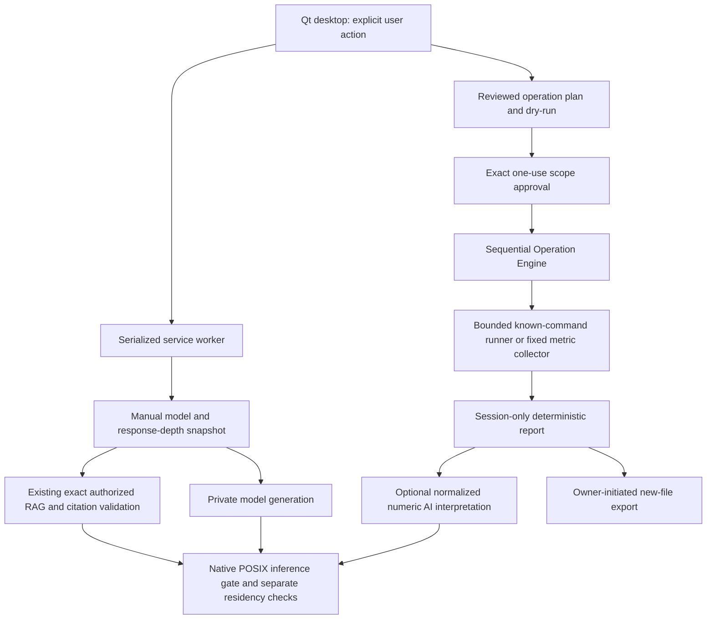

# Phase 2B architecture

ZORVYQ extends the existing Qt desktop and `friday.*` services incrementally. No
assistant rebuild, repository rename, startup replacement, data migration, model
removal or knowledge reindexing is part of this checkpoint.

The GUI has separate Cybersecurity Chat, Cybersecurity Operations and System
Operations surfaces. All long work runs off the GUI thread; one worker serializes
model generation, metadata refresh, operations, analysis and shutdown. Operation
scheduling uses its own lock/cancellation event, separate from the model gate. There
are no unattended schedules or additional polling workers. Existing 15-second
metadata refresh pauses during active work.

`zorvyq/model_modes.py` defines model-compatible final-answer depth budgets.
`zorvyq/diagnostics.py` maps fixed safe categories and allowlisted scalar status.
`Controller` retains the original tool/permission composition and Qwen RAG guard;
manual specialist and report analysis are private, separate generation paths.
`Residency` conservatively releases unchanged app-created residencies. Ordinary
model requests and existing Nomic embedding requests retain zero keep-alive.

`zorvyq/operations` contains contracts, reviewed registry, single-use permission,
engine/scheduler, bounded runner, metadata collectors/parsers and reporting.
`zorvyq/desktop/operations.py` supplies cards, exact plan dialogs, live console,
cancellation, structured reports and optional export/analysis. Importing modules or
opening the dashboard runs no diagnostic command.

Operation output is untrusted data. It cannot authorize commands, change registry
policy or trigger execution. AI receives numeric observations only and has no
operation runner/tool authority. Successful interpretation must reference supplied
measurement IDs; it remains explicitly unverified. The deterministic report survives
analysis failure. Raw reports, process metadata and logs are not automatically saved.

Future modules are registry-only unavailable entries. Each needs review of inputs,
commands, privileges, side effects, resource bounds, parsing and owner acceptance
before executable stages are added. No generic shell, package installer, privilege
elevation or repair mechanism is available through the engine.

See [engine policy](ZORVYQ_OPERATION_ENGINE.md), [model modes](ZORVYQ_MODEL_MODES.md),
[system diagnosis](ZORVYQ_SYSTEM_DIAGNOSIS.md), and the
[checkpoint report](ZORVYQ_PHASE2B_REPORT.md).
