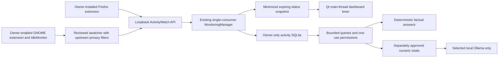

# ZORVYQ Phase 2D-LIVE report

Date: 2026-11-10. Implementation extends `zorvyq/awareness`; it does not create a competing monitoring engine. Extensive pre-existing tracked/untracked changes were preserved. No AGENTS.md was found. Initial `git status --short`, `git diff --stat`, and `git diff --check` were run. No reset, commit or push occurred.

## Outcome and actual runtime status

| State | Evidence / result |
| --- | --- |
| Official release present | Reused existing ActivityWatch v0.14.1 source/archive/runtime. Verified archive SHA-256 and executable hashes. |
| Executables compatible | Selected server and standalone Wayland watcher `--help` succeed; dynamic-library inventory has no missing dependencies. |
| Server can run | Real disposable Python server launched successfully with isolated temporary data. |
| Server responsive | Actual loopback `/api/0/buckets/` response: HTTP 200, empty JSON object. |
| Binding verified | `/proc/net/tcp*` listener inventory contained only `127.0.0.1:5600` for the disposable check. |
| Server left running | No. Smoke-check process stopped; temporary storage removed. |
| Desktop | Inherited session is Ubuntu GNOME Wayland; GNOME Shell 50.1. |
| Compatible watcher installed | Standalone reviewed `aw-awatcher` v0.4.0, official project ZIP and SHA-256 verified. |
| GNOME extension active | Not activated by Codex. Owner must install/review/enable the Shell 50-compatible Focused Window D-Bus extension. |
| Real owner events observed | None. Collection was not enabled. VS Code → Firefox acceptance remains owner-operated. |
| Firefox extension | Not installed/activated by Codex; actual browser events unverified. |
| GUI/login startup | Existing working GUI autostart untouched; content SHA-256 `99bb555ca2f956163883a04ec38c92438456796d3a72b4e46cd5d7d68570f631` unchanged. |
| Independent background unit | Implemented, default OFF, not installed/enabled on this host. Installation requires the explicit UI confirmation. |

Installation is complete locally; live desktop monitoring is **not yet accepted**. Missing extension/watcher evidence displays **Watcher unavailable**, not ON or an invented current application.

## Implemented architecture



The optional managed runtime starts only after the relevant consent switches are enabled. It creates no tray, sync/input watcher or system service. An existing responsive server and identified external watcher are reused rather than duplicated. Only owned child handles are stopped. The manager's advisory lock prevents concurrent GUI/background consumers. Pause/disable rejects in-flight writes at fresh privacy boundaries; source corrections reconcile atomically. Unexpected worker errors hide current data and become ERROR; bounded retries recover from outages.

Supported states are OFF, STARTING, ON, PAUSED, SERVICE UNAVAILABLE, WATCHER UNAVAILABLE and ERROR. ON requires recent valid foreground and idle evidence. Current activity uses observed source timestamps and non-idle intersections; it does not increase a duration after observations stop. Firefox live display includes approved domain, category, observed duration and independently enabled safe title/URL. Unknown/private/sensitive data fails closed.

The one-second dashboard timer reads a bounded status snapshot and updates widgets on the GUI thread. History queries and user-service changes use QThreads and Qt signals; monitoring threads never touch widgets. Last 3 Activities contains completed application records only, descending by completion time, with safe view/resume actions. The existing completed-task card stays separate. No model is used for polling, ordinary metrics or factual answers.

GNOME upstream filters blank every window title and anonymize sensitive/excluded/unapproved activity to a neutral marker. That marker supplies transition boundaries (including returning to ZORVYQ) but never becomes a ZORVYQ activity row. It reveals an excluded-activity transition to upstream storage without revealing its application/title. Optional titles therefore remain unavailable from the managed app watcher; independently reviewed watchers/browser events can supply safe titles after opt-in.

Metrics reuse ResourceMonitor and read-only collectors: CPU counters, RAM, disk, battery, interfaces and uptime at most once per minute. Own-process names/PIDs/RSS/CPU and aggregate connection counts have additional explicit switches. No command lines, executable paths, remote addresses/ports, packets or credentials are persisted by those scopes. Sampling overhead has not been benchmarked on a long-running owner session.

## Persistence and preservation

The actual existing activity database was inspected read-only: schema v3, mode 0600, quick-check `ok`, zero activities and zero stored metric rows. It was not modified during implementation. GUI launch will migrate it transactionally to schema v5, preserving records. No My Tasks, assistant-memory or cybersecurity stores were changed by this work.

Schema v5 preserves the indexed canonical `activities` timeline and adds `website_categories`, `activity_sessions`, and singleton `monitoring_status`. `applications`, `window_activity` and `browser_activity` are named views over that timeline. Existing `preferences`, `system_metrics`, `monitoring_events`, and `deleted_events` remain. UTC timestamps, duration clipping, AFK correlation, completed/interrupted distinction, duplicate/source correction handling, tombstones, owner-only storage, secure-delete, integrity checks and retention continue. Migrations reject future unsupported versions.

Long overlapping foreground intervals fetch their actual idle evidence, including a tested two-hour interval. The ordinary import overlap remains bounded; extended downtime, API saturation, multiple device streams and unsupported schemas can leave gaps. Missing time is never filled from launches or wall time. Browser and application totals remain separate.

## Permissions and intelligence

All requested phrases are intercepted by the existing exact-plan one-use permission route:

- “What application am I using?”
- “What were my last three activities?”
- “What was I doing yesterday?”
- “How much time did I spend programming?”
- “Which websites did I visit today?”
- “Summarize today's activity.”

The ordinary summary phrase returns deterministic recorded totals. The separate local-summary button requires an additional approval and passes only numeric totals under fixed category labels to the selected existing local model. Its activity-specific HTTP transport permits numeric loopback Ollama only, with no proxies or redirects. No raw history, SQL execution, filesystem handle or tool authority reaches the model. Model failure preserves factual output. No live inference was performed.

Login monitoring defaults OFF and uses existing GUI startup. Independent background monitoring is separately approved, installs only the reviewed user unit, visibly enables login monitoring, stops at graphical logout and uses the same consumer lock/status database. Existing GUI startup is unchanged. See the integration guide for exact unit contents, control behavior and failure handling.

## Files created and extended

New in this LIVE continuation:

- `zorvyq/awareness/runtime.py`: verified executable discovery, GNOME readiness probe, upstream filter generation, owned runtime lifecycle.
- `zorvyq/awareness/background.py`: explicit user-service template/installation and bounded service calls.
- `zorvyq/awareness/__main__.py`: status, pause/resume/disable and opt-in daemon entry point.
- `zorvyq/awareness/local_model.py`: activity-only local model transport.
- `scripts/verify_activitywatch_runtime.py`: checksum/binary/server-only smoke verifier.
- `tests/test_zorvyq_phase2d_live.py`: synthetic lifecycle, privacy, offline, background, metric, query and persistence checks.
- `docs/ZORVYQ_PHASE2D_LIVE_REPORT.md`.

Extended/preserved from the preceding awareness work:

- `zorvyq/awareness/monitor.py`, `store.py`, `privacy.py`, `intelligence.py`, `system_monitor.py`.
- `zorvyq/desktop/awareness.py`, `zorvyq/desktop/app.py`, `zorvyq/services.py`.
- `friday/providers/ollama.py`: optional per-instance transport hook; ordinary provider behavior unchanged.
- `tests/test_zorvyq_phase2d.py`, `tests/test_zorvyq_phase2d_ui.py`.
- `third_party/activitywatch-manifest.json`, `.gitignore`, `README.md`, architecture/privacy/setup/Phase 2D documents.

Isolated third-party artifacts: existing official ActivityWatch release/source plus the missing reviewed standalone awatcher source/runtime/archive. No new Python packages, apt packages or system-wide installations. No unrelated source rewrite or data deletion. Because much of the project was already untracked, `git diff --stat` alone does not list these files; review the paths above and `git status` too.

## Validation

- Targeted synthetic backend/offscreen GUI suite: **56 tests passed** (`/tmp/zorvyq-phase2d-live-targeted.log`).
- Final full regression: **1,918 tests passed** (`/tmp/zorvyq-phase2d-live-regression-unrestricted.log`), including all existing tests and the new integration cases.
- The sandboxed full run reproduced the baseline's four local-IPC browser errors and four associated failures. The outside-sandbox reruns passed; no browser implementation was changed for these restrictions.
- Python AST parsing: 13 runtime/awareness/GUI files passed.
- `git diff --check`: passed.
- Actual server-only smoke check: passed with loopback listener verification; no watcher launched.
- Offline recovery/history test: DNS and external Python socket connections denied while synthetic ingestion, SQLite queries, outage recovery and one-use queries passed. This is an actual test of that boundary with mocked watcher input; physical disconnected GNOME/Firefox/Ollama operation is unverified.

Coverage includes runtime discovery/checksum tampering, separate server/watcher states, start/stop/pause, current/finished intervals, long durations, lagging AFK evidence, neutral excluded transitions, stale/future/contradictory events, duplicate suppression, browser opt-in/privacy, SQLite migration/integrity/atomic rollback, custom categories, source correction, shared-status scope/expiry, GUI cards/current status, no fabricated answers, one-use grants, model endpoint isolation, no unconsented runtime/service launch, own-process minimization and connection-count privacy.

## Owner acceptance — required before calling monitoring working

1. Open ZORVYQ (`bin/zorvyq`); verify Activity & Privacy controls and truthful OFF/unavailable state. Do not alter the working GUI autostart.
2. Review and install/activate the GNOME Shell 50-compatible [Focused Window D-Bus extension](https://extensions.gnome.org/extension/5592/focused-window-d-bus/). Its UUID is `focused-window-dbus@flexagoon.com`; activate using the normal GNOME UI. No extension was activated by Codex.
3. In Activity & Privacy, confirm approved IDs (defaults include `code`, `firefox`, `org.gnome.Nautilus`) and exclusions. Enable the managed local runtime and application monitoring separately. Leave titles/URLs/browser/background OFF unless desired.
4. Confirm ON only after fresh window and AFK heartbeats. If it says Watcher unavailable, stop and diagnose extension activation/compatibility; installed executables are not proof of events.
5. Open VS Code and use it for roughly 20 seconds; switch to Firefox for 20 seconds; switch to Files for 20 seconds; return to ZORVYQ. Allow several seconds for polling/idle evidence. The return transition is anonymized upstream and must close Files without recording ZORVYQ as approved usage.
6. Check the three completed app rows, timestamps, measured non-idle durations, categories and Last 3 Activities ordering. Current/unfinished events must not appear as completed. Compare the history with your actual actions; missing observations must be reported rather than invented.
7. Ask each supported question, deny one request, then approve another once. Compare deterministic answers with history; no model call is needed. Use the separately approved local-summary button only if desired.
8. Close/reopen ZORVYQ and verify history persistence. With Start Monitoring at Login OFF, use Start monitoring now to resume intentionally. Existing completed tasks remain separate and unchanged.
9. Pause monitoring, switch applications, and confirm no new ZORVYQ history is added. Stop independently running upstream watchers separately if applicable. Resume intentionally and confirm the new scope does not import paused time.
10. For Firefox metadata only if desired: install the official browser watcher through Firefox's permission UI, disable private-window access, review upstream exclusions, enable ZORVYQ browser monitoring and approve exact domains. Check actual domain/time/category rows and sensitive exclusions. Do not infer website data from browser process presence.
11. Enable stored system metrics separately and wait for samples; verify CPU/RAM/disk/uptime/battery display and sample timestamps. CPU utilization requires a second sample. Process/network scopes remain separate.
12. Only if desired, enable Start Monitoring at Login; log out/in and verify fresh watcher reconnection with the existing GUI autostart. For collection after GUI close, separately approve independent background monitoring and verify its user service, pause/disable behavior, single consumer and logout shutdown. Reboot acceptance remains manual.

## Start, stop, uninstall, limitations

Start through Activity & Privacy → Start monitoring now. Stop through Stop monitoring (application and stored-metric collection); Pause/Resume controls retain explicit consent. Commands:

```bash
.venv/bin/python -B -m zorvyq.awareness status
.venv/bin/python -B -m zorvyq.awareness pause
.venv/bin/python -B -m zorvyq.awareness resume
.venv/bin/python -B -m zorvyq.awareness disable
# After explicit user-service installation only:
systemctl --user stop zorvyq-awareness.service
systemctl --user disable --now zorvyq-awareness.service
```

The [integration guide](ZORVYQ_ACTIVITYWATCH_INTEGRATION.md) documents server setup, extension steps, troubleshooting, updates/removal and offline operation. The [privacy document](ZORVYQ_ACTIVITY_PRIVACY.md) explains upstream storage, neutral boundaries, sensitive-screen limitations, retention, database security and external-dependency limits.

Remaining owner interaction: GNOME extension installation/activation, actual desktop-switch acceptance, optional Firefox setup, optional startup/background consent and login/logout/reboot checks. No real private activity collection, extension activation, model inference or owner acceptance was fabricated. Continuous resource overhead and all upstream dependency network behavior remain unbenchmarked/unaudited; no assertion of perfect continuous coverage or zero ActivityWatch network activity is made.
